# Poker API — схема взаимодействия

Чистая версия схемы из `Poker_API_extended.drawio`, собранная на Mermaid.

Связанные документы — правила игры в [`game-rules.md`](./game-rules.md), функции БД в [`sql-functions.md`](./sql-functions.md), схема данных — `poker_DB.drawio`.

**Участники**

| Обозначение | Роль |
|---|---|
| `U` | Пользователь — человек за интерфейсом |
| `C` | Клиент — фронтенд, хранит Auth Token |
| `S` | Сервер — вся бизнес-логика и валидация |
| `DB` | База данных |

Везде, где игрок уже авторизован, клиент прикладывает `Auth Token`, и проверяет его **сервер**, а не БД.

---

## Жизненный цикл партии

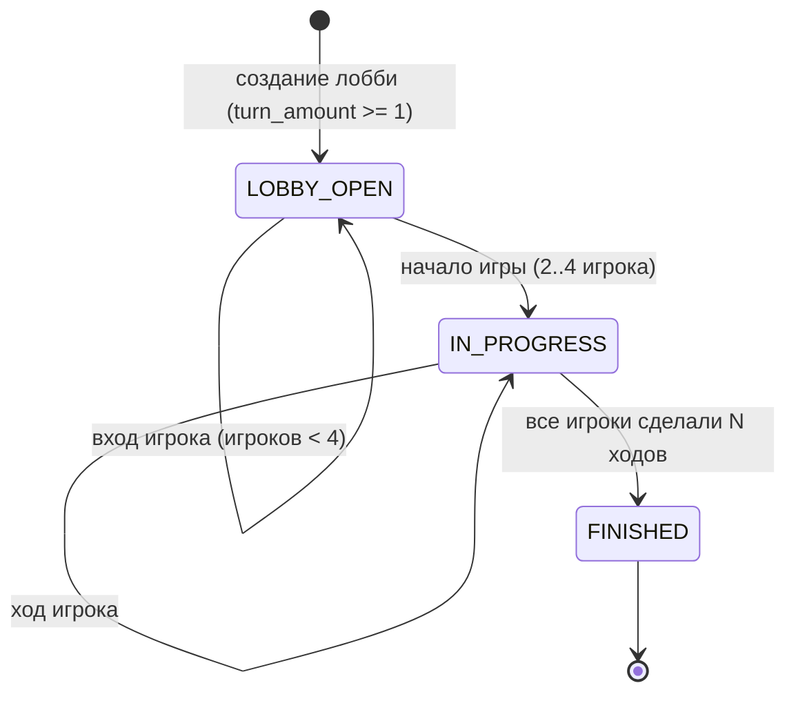

Ход внутри `IN_PROGRESS`:

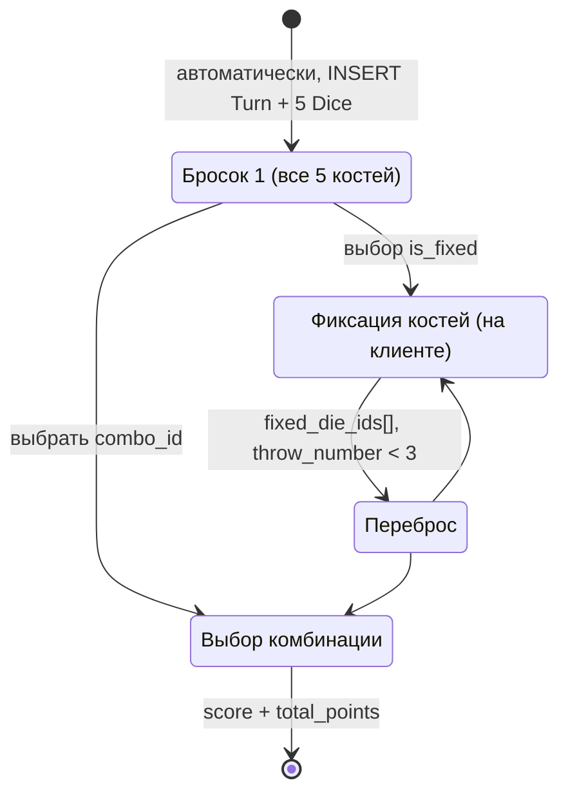

---

## 1. Авторизация / регистрация

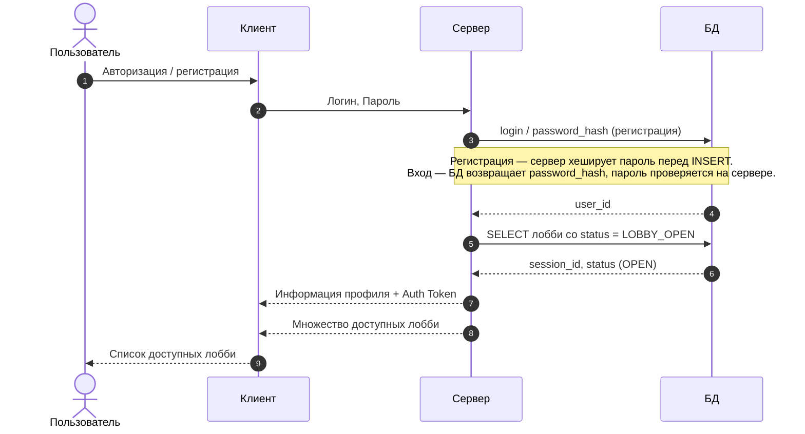

## 2. Создание лобби

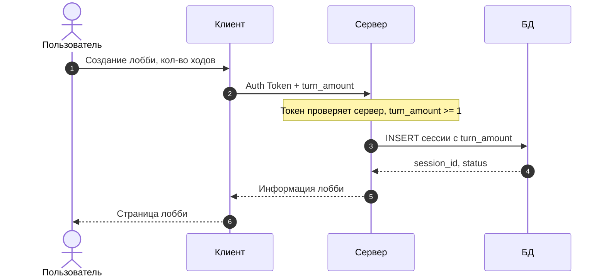

## 3. Поиск лобби

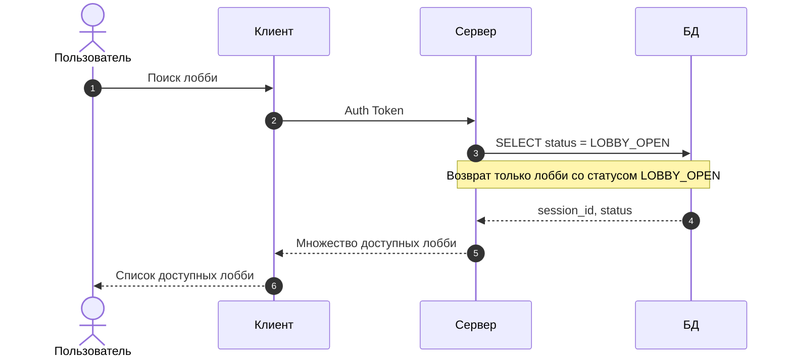

## 4. Вход в лобби

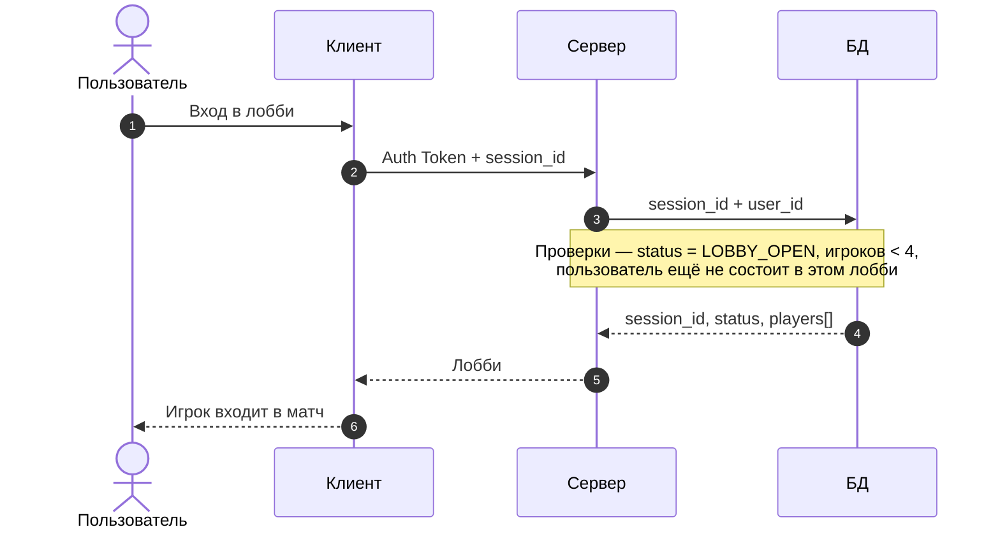

## 5. Начало игры и первый бросок

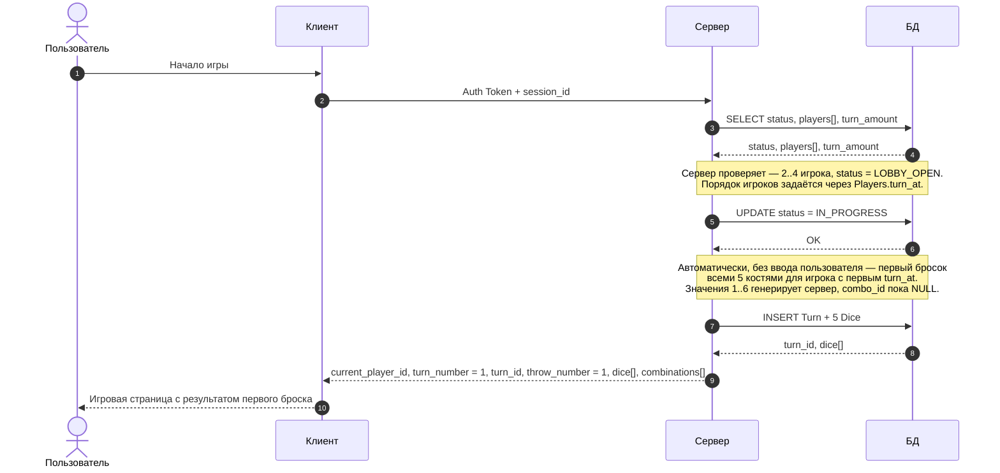

## 6. Фиксация костей и повторный бросок

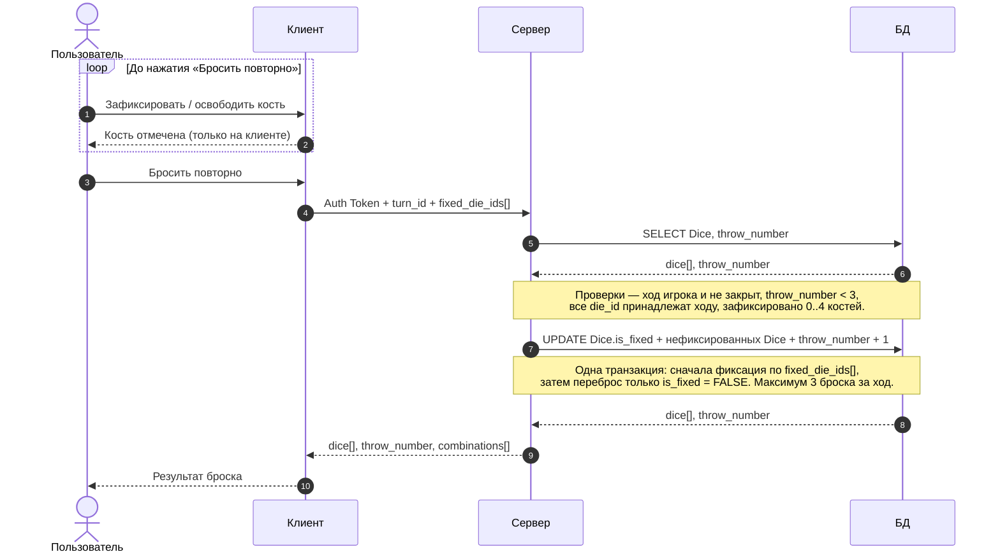

## 7. Выбор комбинации / завершение хода

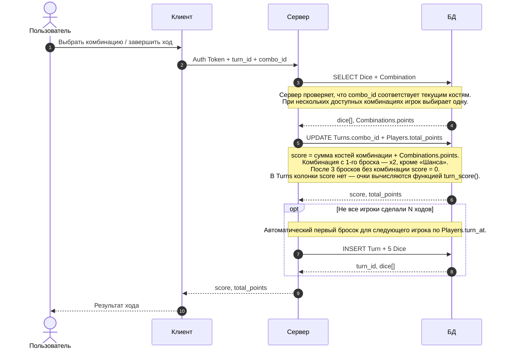

## 8. Состояние партии (short-polling)

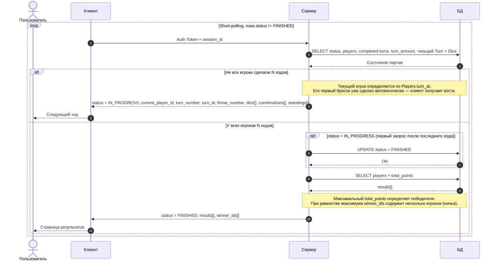

## 9. Выход из матча

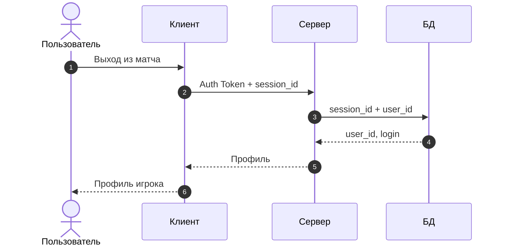

---

## Сводка данных

| Сценарий | Клиент → Сервер | Сервер → Клиент |
|---|---|---|
| Авторизация / регистрация | Логин, Пароль | Профиль + Auth Token, список лобби |
| Создание лобби | Auth Token + turn_amount | session_id, status |
| Поиск лобби | Auth Token | Множество лобби со status = LOBBY_OPEN |
| Вход в лобби | Auth Token + session_id | session_id, status, players[] |
| Начало игры и первый бросок | Auth Token + session_id | current_player_id, turn_number = 1, turn_id, throw_number = 1, dice[], combinations[] |
| Фиксация и повторный бросок | Auth Token + turn_id + fixed_die_ids[] | dice[], throw_number, combinations[] |
| Завершение хода | Auth Token + turn_id + combo_id | score, total_points |
| Состояние партии (polling) | Auth Token + session_id | `IN_PROGRESS`: current_player_id, turn_number, turn_id, throw_number, dice[], combinations[], standings[] `FINISHED`: results[], winner_ids[] |
| Выход из матча | Auth Token + session_id | Профиль игрока |
