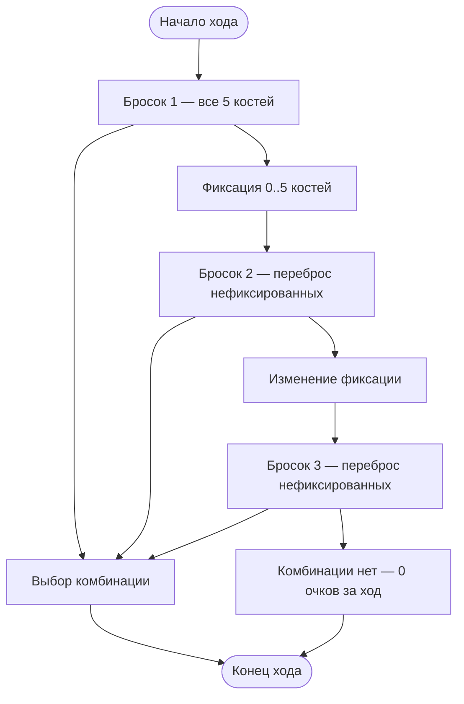
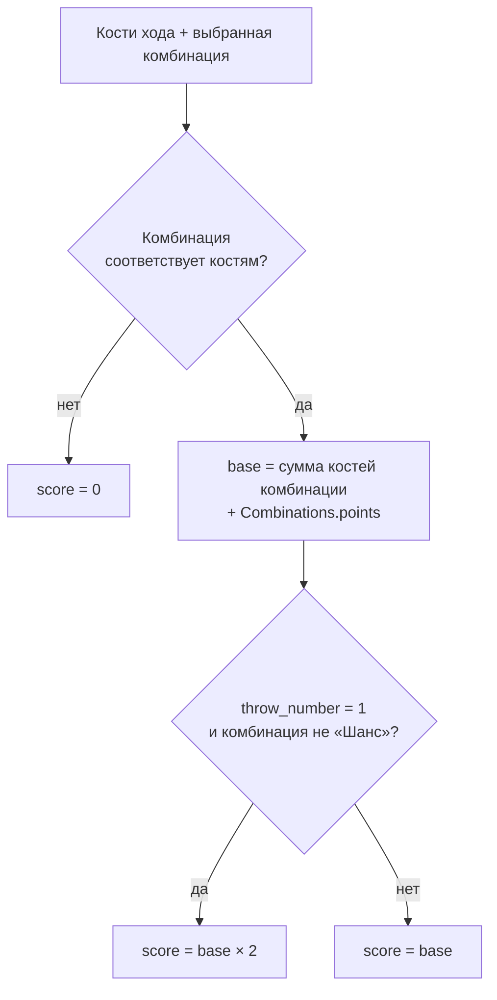
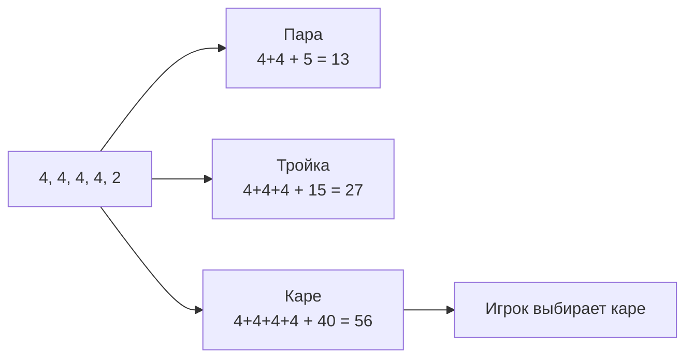
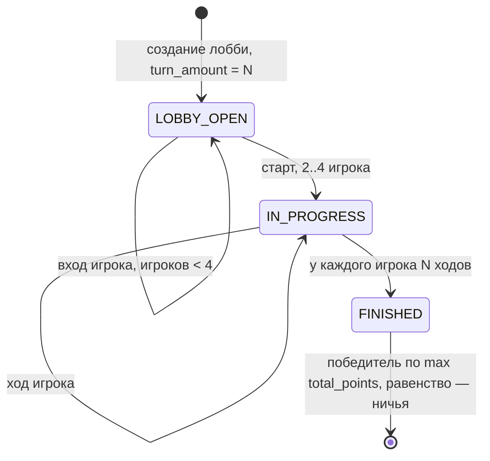

# Правила игры «Покер на костях»

Источник — `БД_ПокерНаКостях_Правила.docx`. Этот документ фиксирует правила как требования к БД: на него ссылаются [`sql-functions.md`](./sql-functions.md) и [`api-schema.md`](./api-schema.md).

---

## 1. Общие положения

| Параметр | Значение | Где в БД |
|---|---|---|
| Число игроков | от 2 до 4 | `Players` на одну `Game_sessions` |
| Число костей | 5 стандартных | `Dice` на один `Turns` |
| Значения кости | `1..6` | `Dice.value` |
| Число ходов в партии | `N`, задаётся перед началом партии | `Game_sessions.turn_amount` |
| Ходов на игрока | ровно `N` | `Turns.turn_number` в `1..N` |
| Цель | набрать максимум очков за `N` ходов | `Players.total_points` |

После завершения последнего хода производится итоговый подсчёт очков.

---

## 2. Порядок хода

* В течение одного хода игрок выполняет **не более трёх бросков**.
* Первый бросок — **всеми пятью** костями.
* После первого и второго бросков игрок может зафиксировать **от 0 до 5** костей. Зафиксированные кости сохраняют значение и не участвуют в следующем броске, остальные перебрасываются.
* Перед очередным броском выбор можно изменить: снять фиксацию с ранее отложенных костей или зафиксировать другие.
* Игрок **имеет право** выполнять оставшиеся броски после получения комбинации — комбинация не обязывает закончить ход.



## 3. Завершение хода

Ход закрывается выбором комбинации — на любом из трёх бросков. Если после трёх бросков не выпало ни одной комбинации, игрок получает **0 очков** за текущий ход.

---

## 4. Допустимые комбинации

| Комбинация | Условие | Пример | Очки за комбинацию |
|---|---|---|---|
| Пара | Две кости одного достоинства | `2, 2` | 5 |
| Две пары | Две кости одного достоинства и две кости другого достоинства | `3, 3, 6, 6` | 10 |
| Тройка | Три кости одного достоинства | `1, 1, 1` | 15 |
| Малый стрит | Последовательность из четырёх значений | `1, 2, 3, 4` | 20 |
| Большой стрит | Последовательность из пяти значений | `1, 2, 3, 4, 5` | 25 |
| Чёт | Все пять костей имеют чётные значения | `2, 2, 4, 4, 6` | 30 |
| Нечёт | Все пять костей имеют нечётные значения | `1, 3, 3, 5, 5` | 30 |
| Фул-хаус | Пара и тройка одновременно | `1, 1, 3, 3, 3` | 35 |
| Каре | Четыре кости одного достоинства | `4, 4, 4, 4` | 40 |
| Покер | Пять костей одного достоинства | `5, 5, 5, 5, 5` | 50 |
| Шанс | Любые пять костей с разными значениями | `1, 2, 4, 5, 6` | 2 |

* Малый стрит может иметь вид `1–2–3–4`, `2–3–4–5` или `3–4–5–6`.
* Большой стрит может иметь вид `1–2–3–4–5` или `2–3–4–5–6`.

Эта таблица — содержимое справочника `Combinations` (`name`, `points`).

---

## 5. Начисление очков

Очки за ход — сумма значений костей, которые образуют комбинацию, **плюс** очки самой комбинации.

```
score = сумма костей комбинации + Combinations.points
если комбинация выпала после первого броска и это не «Шанс» → score × 2
```

Пример из правил: две пары `3, 3` и `6, 6` → `3 + 3 + 6 + 6 = 18` очков + очки за комбинацию (10) = **28**.



Сколько костей входит в сумму для каждой комбинации:

| Комбинация | Кости в сумме |
|---|---|
| Пара | 2 |
| Две пары | 4 |
| Тройка | 3 |
| Каре | 4 |
| Покер | 5 |
| Фул-хаус | 5 (3 + 2) |
| Малый стрит | 4 кости последовательности |
| Большой стрит | 5 |
| Чёт, Нечёт, Шанс | 5 |

---

## 6. Выбор комбинации при нескольких вариантах

Если результат броска одновременно соответствует нескольким комбинациям, игрок выбирает **одну** — очки начисляются только за неё.

Пример из правил: `4, 4, 4, 4, 2` подходит под «пару», «тройку» и «каре». Игрок сам выбирает наиболее выгодный вариант.



Кости, не входящие в выбранную комбинацию, в сумму не идут (`2` в примере выше не учитывается).

---

## 7. Завершение партии

* Партия заканчивается, когда **каждый** игрок выполнил `N` ходов.
* Побеждает игрок с наибольшей суммой очков за все ходы.
* При равенстве максимума между этими игроками объявляется **ничья**.



---

## Правила → функции БД

| Правило | Функции из [`sql-functions.md`](./sql-functions.md) |
|---|---|
| 2..4 игрока, `N` ходов | `create_lobby`, `join_lobby`, `start_game`, `trg_players_limit` |
| Не более трёх бросков за ход | `begin_turn`, `reroll_dice` (проверка `throw_number < 3`) |
| Первый бросок — всеми костями | `begin_turn` |
| Фиксация 0..5 костей, изменение выбора | `set_dice_fixed` |
| Переброс только нефиксированных | `reroll_dice` |
| Набор комбинаций и их условия | `has_pair` … `has_chance`, `combo_matches` |
| Сумма костей комбинации | `combo_dice_sum` |
| Удвоение с первого броска, кроме «Шанса» | `calc_score` |
| 0 очков, если комбинации нет | `skip_turn`, `calc_score` |
| Выбор одной из нескольких комбинаций | `available_combinations`, `finish_turn` |
| Партия окончена, когда у всех `N` ходов | `is_session_complete`, `finish_session` |
| Победитель по максимуму очков, ничья | `get_winners`, `get_standings` |

---

## Вопросы по правилам, влияющие на реализацию

1. **Сумма при нескольких способах собрать комбинацию.** На костях `3, 3, 6, 6, 6` «пару» можно собрать как `3+3` или как `6+6`. В правилах это не оговорено — в функциях принято брать **максимальную** сумму, что согласуется с п. 6 («игрок выбирает наиболее выгодный вариант»).
2. **Повторное использование комбинаций.** В правилах нет запрета закрывать одну и ту же комбинацию несколько раз за партию, и схема БД такого ограничения не содержит (`Turns` допускает любой `combo_id`). Реализовано как **разрешено**.
3. **Шанс против Большого стрита.** `1,2,3,4,5` — это и «Шанс» (пять разных значений), и «Большой стрит». По п. 6 выбирает игрок, обе комбинации попадают в `available_combinations`.
4. **Чёт/Нечёт против пар и тройки.** `2,2,4,4,6` — одновременно «Чёт» и «Две пары». Тот же механизм выбора.
