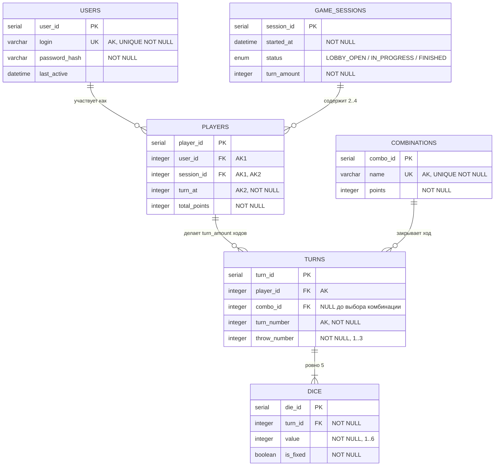
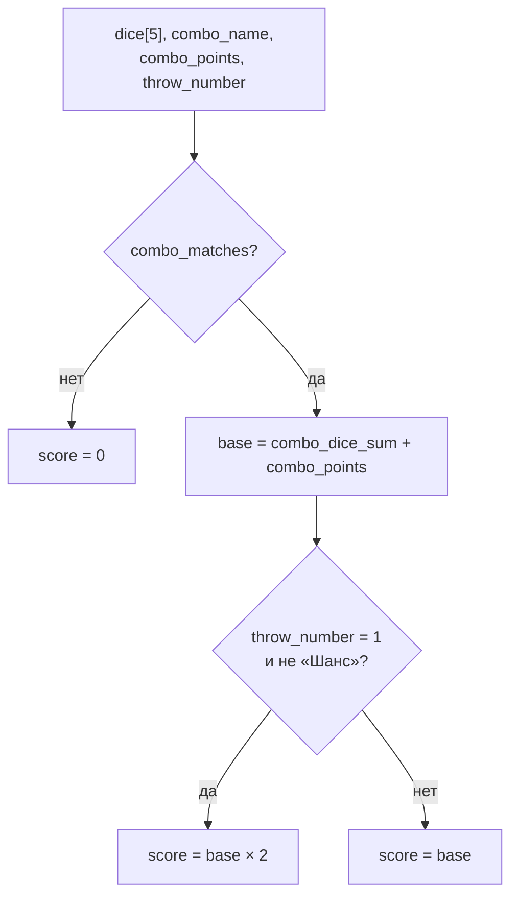
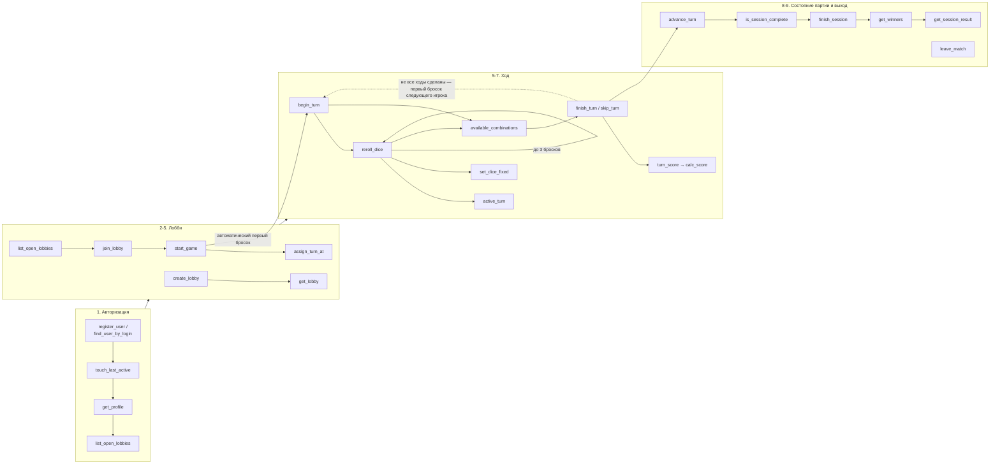

# Poker API — SQL-функции

Договорённости:

* Диалект — **PostgreSQL**, функции на `PL/pgSQL`, расчёты комбинаций — на `SQL` с `IMMUTABLE`.
* Идентификаторы — `SERIAL`/`integer`, как в схеме.
* Пароль **не** попадает в БД: `register_user` принимает готовый `password_hash`.
* Auth Token в схеме не хранится — его держит и проверяет сервер (см. `api-schema.md`); БД отмечает только `Users.last_active`.
* Валидация бизнес-правил — внутри функций, через `RAISE EXCEPTION ... USING ERRCODE`, см. [Коды ошибок](#коды-ошибок).
* Кости передаются как `integer[]` — идентификаторы (`die_id`) или значения `1..6`.

---

## Модель данных



Ссылочные действия из схемы: `Players → Users`, `Players → Game_sessions`, `Turns → Players`, `Dice → Turns` — `ON UPDATE CASCADE ON DELETE CASCADE`; `Turns → Combinations` — `ON UPDATE CASCADE ON DELETE SET NULL`.

**Ключевое следствие для функций:** ход адресуется через `player_id`, а не через пару (`session_id`, `user_id`) — `Players` имеет собственный суррогатный ключ, уникальный в пределах сессии (`AK1 = user_id + session_id`), и порядок хода хранится в `Players.turn_at`.

### DDL

```sql
CREATE TYPE session_status AS ENUM ('LOBBY_OPEN', 'IN_PROGRESS', 'FINISHED');

CREATE TABLE Users (
    user_id       serial PRIMARY KEY,
    login         varchar   NOT NULL UNIQUE,
    password_hash varchar   NOT NULL,
    last_active   timestamp
);

CREATE TABLE Game_sessions (
    session_id  serial PRIMARY KEY,
    started_at  timestamp      NOT NULL DEFAULT now(),
    status      session_status NOT NULL DEFAULT 'LOBBY_OPEN',
    turn_amount integer        NOT NULL CHECK (turn_amount >= 1)
);

CREATE TABLE Combinations (
    combo_id serial PRIMARY KEY,
    name     varchar NOT NULL UNIQUE,
    points   integer NOT NULL
);

CREATE TABLE Players (
    player_id    serial PRIMARY KEY,
    user_id      integer NOT NULL REFERENCES Users (user_id)
                         ON UPDATE CASCADE ON DELETE CASCADE,
    session_id   integer NOT NULL REFERENCES Game_sessions (session_id)
                         ON UPDATE CASCADE ON DELETE CASCADE,
    turn_at      integer NOT NULL,
    total_points integer NOT NULL DEFAULT 0,
    UNIQUE (user_id, session_id),
    UNIQUE (session_id, turn_at) DEFERRABLE INITIALLY DEFERRED
);

CREATE TABLE Turns (
    turn_id     serial PRIMARY KEY,
    player_id   integer NOT NULL REFERENCES Players (player_id)
                        ON UPDATE CASCADE ON DELETE CASCADE,
    combo_id    integer REFERENCES Combinations (combo_id)
                        ON UPDATE CASCADE ON DELETE SET NULL,
    turn_number integer NOT NULL,
    throw_number integer NOT NULL,
    is_closed   boolean NOT NULL DEFAULT FALSE,
    UNIQUE (player_id, turn_number)
);

CREATE TABLE Dice (
    die_id   serial PRIMARY KEY,
    turn_id  integer NOT NULL REFERENCES Turns (turn_id)
                     ON UPDATE CASCADE ON DELETE CASCADE,
    value    integer NOT NULL,
    is_fixed boolean NOT NULL DEFAULT FALSE
);
```

`CHECK`-ограничения на `Dice.value` и `Turns.throw_number` задаются в разделе 6 (`trg_dice_value_range`, `trg_turns_throw_range`).

### Расхождения со схемой, которые закрывают функции

* В `Turns` добавлена колонка `is_closed boolean NOT NULL DEFAULT FALSE`. По схеме ход закрывается выбором комбинации (`combo_id IS NOT NULL`), но ход, пропущенный после третьего броска, тоже без комбинации — отличить его от текущего хода без флага нельзя. Флаг ставят `finish_turn` и `skip_turn`.
* Ограничение `UNIQUE (session_id, turn_at)` (`AK2`) объявлено `DEFERRABLE INITIALLY DEFERRED`, иначе перенумерация `turn_at` в `leave_lobby` и `assign_turn_at` упирается в уникальность посреди `UPDATE`.

---

## 1. Пользователи и вход

| Функция | Аргументы | Возвращает | Назначение | Проверки | PostgreSQL |
|---|---|---|---|---|---|
| `register_user` | `p_login varchar`, `p_password_hash varchar` | `integer` (`user_id`) | Регистрация, `INSERT INTO Users` | `login` уникален и непустой, хеш непустой | <details><summary>SQL</summary><pre>CREATE FUNCTION register_user(p_login varchar, p_password_hash varchar) RETURNS integer<br>LANGUAGE plpgsql AS &#36;&#36;<br>DECLARE<br>    v_user_id integer;<br>BEGIN<br>    IF coalesce(btrim(p_login), '') = '' OR coalesce(p_password_hash, '') = '' THEN<br>        RAISE EXCEPTION 'invalid_argument' USING ERRCODE = '22023';<br>    END IF;<br>    IF EXISTS (SELECT 1 FROM users WHERE login = p_login) THEN<br>        RAISE EXCEPTION 'login_already_taken' USING ERRCODE = '23505';<br>    END IF;<br>    INSERT INTO users (login, password_hash) VALUES (p_login, p_password_hash)<br>    RETURNING user_id INTO v_user_id;<br>    RETURN v_user_id;<br>END;<br>&#36;&#36;;</pre></details> |
| `find_user_by_login` | `p_login varchar` | `TABLE(user_id integer, login varchar, password_hash varchar)` | Вход — сервер сам сверяет хеш | — (пустой результат = нет пользователя) | <details><summary>SQL</summary><pre>CREATE FUNCTION find_user_by_login(p_login varchar)<br>RETURNS TABLE(user_id integer, login varchar, password_hash varchar)<br>LANGUAGE sql STABLE AS &#36;&#36;<br>    SELECT u.user_id, u.login, u.password_hash FROM users u WHERE u.login = p_login<br>&#36;&#36;;</pre></details> |
| `touch_last_active` | `p_user_id integer` | `void` | `UPDATE Users.last_active = now()` при каждом запросе с валидным токеном | пользователь существует | <details><summary>SQL</summary><pre>CREATE FUNCTION touch_last_active(p_user_id integer) RETURNS void<br>LANGUAGE plpgsql AS &#36;&#36;<br>BEGIN<br>    UPDATE users SET last_active = now() WHERE user_id = p_user_id;<br>    IF NOT FOUND THEN<br>        RAISE EXCEPTION 'user_not_found' USING ERRCODE = 'P0100';<br>    END IF;<br>END;<br>&#36;&#36;;</pre></details> |
| `get_profile` | `p_user_id integer` | `TABLE(user_id integer, login varchar, last_active datetime, games_played integer, games_won integer, best_total integer)` | Страница профиля (сценарии 1 и 9), агрегаты по `Players` | пользователь существует | <details><summary>SQL</summary><pre>CREATE FUNCTION get_profile(p_user_id integer)<br>RETURNS TABLE(user_id integer, login varchar, last_active timestamp,<br>              games_played integer, games_won integer, best_total integer)<br>LANGUAGE plpgsql STABLE AS &#36;&#36;<br>#variable_conflict use_column<br>BEGIN<br>    IF NOT EXISTS (SELECT 1 FROM users u WHERE u.user_id = p_user_id) THEN<br>        RAISE EXCEPTION 'user_not_found' USING ERRCODE = 'P0100';<br>    END IF;<br>    RETURN QUERY<br>    SELECT u.user_id, u.login, u.last_active,<br>           count(s.session_id)::integer,<br>           (count(1) FILTER (WHERE p.total_points = m.max_points))::integer,<br>           coalesce(max(p.total_points) FILTER (WHERE s.session_id IS NOT NULL), 0)::integer<br>    FROM users u<br>    LEFT JOIN players p ON p.user_id = u.user_id<br>    LEFT JOIN game_sessions s ON s.session_id = p.session_id AND s.status = 'FINISHED'<br>    LEFT JOIN LATERAL (SELECT max(p2.total_points) AS max_points<br>                       FROM players p2 WHERE p2.session_id = s.session_id) m ON TRUE<br>    WHERE u.user_id = p_user_id<br>    GROUP BY u.user_id, u.login, u.last_active;<br>END;<br>&#36;&#36;;</pre></details> |

## 2. Лобби

| Функция | Аргументы | Возвращает | Назначение | Проверки | PostgreSQL |
|---|---|---|---|---|---|
| `create_lobby` | `p_user_id integer`, `p_turn_amount integer` | `integer` (`session_id`) | `INSERT Game_sessions` со `status = LOBBY_OPEN` + `join_lobby` создателя | `p_turn_amount >= 1`, пользователь не состоит в другой незавершённой сессии | <details><summary>SQL</summary><pre>CREATE FUNCTION create_lobby(p_user_id integer, p_turn_amount integer) RETURNS integer<br>LANGUAGE plpgsql AS &#36;&#36;<br>DECLARE<br>    v_session_id integer;<br>BEGIN<br>    IF p_turn_amount IS NULL OR p_turn_amount &lt; 1 THEN<br>        RAISE EXCEPTION 'invalid_argument' USING ERRCODE = '22023';<br>    END IF;<br>    IF NOT EXISTS (SELECT 1 FROM users WHERE user_id = p_user_id) THEN<br>        RAISE EXCEPTION 'user_not_found' USING ERRCODE = 'P0100';<br>    END IF;<br>    IF EXISTS (SELECT 1 FROM players p JOIN game_sessions s USING (session_id)<br>               WHERE p.user_id = p_user_id AND s.status &lt;&gt; 'FINISHED') THEN<br>        RAISE EXCEPTION 'already_in_session' USING ERRCODE = 'P0107';<br>    END IF;<br>    INSERT INTO game_sessions (started_at, status, turn_amount)<br>    VALUES (now(), 'LOBBY_OPEN', p_turn_amount)<br>    RETURNING session_id INTO v_session_id;<br>    PERFORM join_lobby(v_session_id, p_user_id);<br>    RETURN v_session_id;<br>END;<br>&#36;&#36;;</pre></details> |
| `list_open_lobbies` | `p_limit integer DEFAULT 50`, `p_offset integer DEFAULT 0` | `TABLE(session_id integer, turn_amount integer, players_count integer, started_at datetime)` | Поиск лобби (сценарий 3) | только `status = LOBBY_OPEN` и `players_count < 4` | <details><summary>SQL</summary><pre>CREATE FUNCTION list_open_lobbies(p_limit integer DEFAULT 50, p_offset integer DEFAULT 0)<br>RETURNS TABLE(session_id integer, turn_amount integer, players_count integer, started_at timestamp)<br>LANGUAGE sql STABLE AS &#36;&#36;<br>    SELECT s.session_id, s.turn_amount, count(p.player_id)::integer, s.started_at<br>    FROM game_sessions s<br>    LEFT JOIN players p ON p.session_id = s.session_id<br>    WHERE s.status = 'LOBBY_OPEN'<br>    GROUP BY s.session_id<br>    HAVING count(p.player_id) &lt; 4<br>    ORDER BY s.started_at DESC, s.session_id DESC<br>    LIMIT p_limit OFFSET p_offset<br>&#36;&#36;;</pre></details> |
| `get_lobby` | `p_session_id integer` | `TABLE(session_id integer, status text, turn_amount integer, players jsonb)` | Карточка лобби: состав игроков с `turn_at` | сессия существует | <details><summary>SQL</summary><pre>CREATE FUNCTION get_lobby(p_session_id integer)<br>RETURNS TABLE(session_id integer, status text, turn_amount integer, players jsonb)<br>LANGUAGE plpgsql STABLE AS &#36;&#36;<br>#variable_conflict use_column<br>BEGIN<br>    IF NOT EXISTS (SELECT 1 FROM game_sessions s WHERE s.session_id = p_session_id) THEN<br>        RAISE EXCEPTION 'lobby_not_found' USING ERRCODE = 'P0101';<br>    END IF;<br>    RETURN QUERY<br>    SELECT s.session_id, s.status::text, s.turn_amount,<br>           coalesce((SELECT jsonb_agg(jsonb_build_object(<br>                         'player_id', p.player_id, 'user_id', p.user_id,<br>                         'login', u.login, 'turn_at', p.turn_at) ORDER BY p.turn_at)<br>                     FROM players p JOIN users u USING (user_id)<br>                     WHERE p.session_id = s.session_id), '[]'::jsonb)<br>    FROM game_sessions s<br>    WHERE s.session_id = p_session_id;<br>END;<br>&#36;&#36;;</pre></details> |
| `join_lobby` | `p_session_id integer`, `p_user_id integer` | `integer` (`player_id`) | `INSERT Players` с `turn_at` = следующий свободный номер, `total_points = 0` | `status = LOBBY_OPEN`, игроков `< 4`, пользователь ещё не в этом лобби | <details><summary>SQL</summary><pre>CREATE FUNCTION join_lobby(p_session_id integer, p_user_id integer) RETURNS integer<br>LANGUAGE plpgsql AS &#36;&#36;<br>DECLARE<br>    v_status    session_status;<br>    v_player_id integer;<br>BEGIN<br>    SELECT status INTO v_status FROM game_sessions WHERE session_id = p_session_id FOR UPDATE;<br>    IF NOT FOUND THEN<br>        RAISE EXCEPTION 'lobby_not_found' USING ERRCODE = 'P0101';<br>    END IF;<br>    IF v_status &lt;&gt; 'LOBBY_OPEN' THEN<br>        RAISE EXCEPTION 'lobby_not_open' USING ERRCODE = 'P0102';<br>    END IF;<br>    IF (SELECT count(1) FROM players WHERE session_id = p_session_id) &gt;= 4 THEN<br>        RAISE EXCEPTION 'lobby_full' USING ERRCODE = 'P0103';<br>    END IF;<br>    IF EXISTS (SELECT 1 FROM players WHERE session_id = p_session_id AND user_id = p_user_id) THEN<br>        RAISE EXCEPTION 'already_joined' USING ERRCODE = 'P0104';<br>    END IF;<br>    INSERT INTO players (user_id, session_id, turn_at, total_points)<br>    SELECT p_user_id, p_session_id, coalesce(max(turn_at), 0) + 1, 0<br>    FROM players WHERE session_id = p_session_id<br>    RETURNING player_id INTO v_player_id;<br>    RETURN v_player_id;<br>END;<br>&#36;&#36;;</pre></details> |
| `leave_lobby` | `p_session_id integer`, `p_user_id integer` | `void` | Выход до старта, `turn_at` остальных пересчитывается; при уходе последнего сессия удаляется | `status = LOBBY_OPEN`, игрок состоит в лобби | <details><summary>SQL</summary><pre>CREATE FUNCTION leave_lobby(p_session_id integer, p_user_id integer) RETURNS void<br>LANGUAGE plpgsql AS &#36;&#36;<br>DECLARE<br>    v_status session_status;<br>BEGIN<br>    SELECT status INTO v_status FROM game_sessions WHERE session_id = p_session_id FOR UPDATE;<br>    IF NOT FOUND THEN<br>        RAISE EXCEPTION 'lobby_not_found' USING ERRCODE = 'P0101';<br>    END IF;<br>    IF v_status &lt;&gt; 'LOBBY_OPEN' THEN<br>        RAISE EXCEPTION 'lobby_not_open' USING ERRCODE = 'P0102';<br>    END IF;<br>    DELETE FROM players WHERE session_id = p_session_id AND user_id = p_user_id;<br>    IF NOT FOUND THEN<br>        RAISE EXCEPTION 'not_in_lobby' USING ERRCODE = 'P0106';<br>    END IF;<br>    IF NOT EXISTS (SELECT 1 FROM players WHERE session_id = p_session_id) THEN<br>        DELETE FROM game_sessions WHERE session_id = p_session_id;<br>    ELSE<br>        UPDATE players p SET turn_at = r.rn<br>        FROM (SELECT player_id, row_number() OVER (ORDER BY turn_at)::integer AS rn<br>              FROM players WHERE session_id = p_session_id) r<br>        WHERE p.player_id = r.player_id;<br>    END IF;<br>END;<br>&#36;&#36;;</pre></details> |
| `start_game` | `p_session_id integer`, `p_user_id integer` | `TABLE(session_id integer, current_player_id integer, turn_number integer, turn_id integer, throw_number integer, dice jsonb)` | `UPDATE status = IN_PROGRESS`, `started_at = now()`, раздача `turn_at`, автоматический первый бросок через `begin_turn` (сценарий 5) | `status = LOBBY_OPEN`, `2..4` игрока | <details><summary>SQL</summary><pre>CREATE FUNCTION start_game(p_session_id integer, p_user_id integer)<br>RETURNS TABLE(session_id integer, current_player_id integer, turn_number integer,<br>              turn_id integer, throw_number integer, dice jsonb)<br>LANGUAGE plpgsql AS &#36;&#36;<br>#variable_conflict use_column<br>DECLARE<br>    v_status  session_status;<br>    v_count   integer;<br>    v_player  integer;<br>BEGIN<br>    SELECT s.status INTO v_status FROM game_sessions s<br>    WHERE s.session_id = p_session_id FOR UPDATE;<br>    IF NOT FOUND THEN<br>        RAISE EXCEPTION 'lobby_not_found' USING ERRCODE = 'P0101';<br>    END IF;<br>    IF v_status &lt;&gt; 'LOBBY_OPEN' THEN<br>        RAISE EXCEPTION 'lobby_not_open' USING ERRCODE = 'P0102';<br>    END IF;<br>    IF NOT EXISTS (SELECT 1 FROM players p WHERE p.session_id = p_session_id AND p.user_id = p_user_id) THEN<br>        RAISE EXCEPTION 'not_in_lobby' USING ERRCODE = 'P0106';<br>    END IF;<br>    SELECT count(1) INTO v_count FROM players p WHERE p.session_id = p_session_id;<br>    IF v_count NOT BETWEEN 2 AND 4 THEN<br>        RAISE EXCEPTION 'not_enough_players' USING ERRCODE = 'P0105';<br>    END IF;<br>    PERFORM assign_turn_at(p_session_id);<br>    UPDATE game_sessions s SET status = 'IN_PROGRESS', started_at = now()<br>    WHERE s.session_id = p_session_id;<br>    v_player := current_player(p_session_id);<br>    RETURN QUERY<br>    SELECT p_session_id, v_player, b.turn_number, b.turn_id, b.throw_number, b.dice<br>    FROM begin_turn(v_player) b;<br>END;<br>&#36;&#36;;</pre></details> |
| `assign_turn_at` | `p_session_id integer` | `void` | Служебная: случайная перестановка `Players.turn_at` в `1..players_count` при старте | вызывается только из `start_game` | <details><summary>SQL</summary><pre>CREATE FUNCTION assign_turn_at(p_session_id integer) RETURNS void<br>LANGUAGE sql AS &#36;&#36;<br>    UPDATE players p SET turn_at = r.rn<br>    FROM (SELECT player_id, row_number() OVER (ORDER BY random())::integer AS rn<br>          FROM players WHERE session_id = p_session_id) r<br>    WHERE p.player_id = r.player_id<br>&#36;&#36;;</pre></details> |
| `leave_match` | `p_session_id integer`, `p_user_id integer` | `TABLE(user_id integer, login varchar)` | Выход из матча (сценарий 9), возвращает профиль | игрок состоит в сессии `IN_PROGRESS`; игрок удаляется вместе со своими ходами (`ON DELETE CASCADE`, очков за незакрытый ход нет), если ход был его — следующему открывается ход через `begin_turn`; если остальные уже сыграли все ходы, партия завершается | <details><summary>SQL</summary><pre>CREATE FUNCTION leave_match(p_session_id integer, p_user_id integer)<br>RETURNS TABLE(user_id integer, login varchar)<br>LANGUAGE plpgsql AS &#36;&#36;<br>#variable_conflict use_column<br>DECLARE<br>    v_status  session_status;<br>    v_player  integer;<br>    v_current integer;<br>BEGIN<br>    SELECT s.status INTO v_status FROM game_sessions s WHERE s.session_id = p_session_id FOR UPDATE;<br>    IF NOT FOUND THEN<br>        RAISE EXCEPTION 'lobby_not_found' USING ERRCODE = 'P0101';<br>    END IF;<br>    IF v_status = 'FINISHED' THEN<br>        RAISE EXCEPTION 'session_finished' USING ERRCODE = 'P0302';<br>    ELSIF v_status &lt;&gt; 'IN_PROGRESS' THEN<br>        RAISE EXCEPTION 'lobby_not_open' USING ERRCODE = 'P0102';<br>    END IF;<br>    SELECT p.player_id INTO v_player FROM players p<br>    WHERE p.session_id = p_session_id AND p.user_id = p_user_id;<br>    IF NOT FOUND THEN<br>        RAISE EXCEPTION 'not_in_lobby' USING ERRCODE = 'P0106';<br>    END IF;<br>    v_current := current_player(p_session_id);<br>    -- незакрытый ход уходит вместе с игроком (ON DELETE CASCADE), очков за него нет<br>    DELETE FROM players p WHERE p.player_id = v_player;<br>    IF NOT EXISTS (SELECT 1 FROM players p WHERE p.session_id = p_session_id) THEN<br>        DELETE FROM game_sessions s WHERE s.session_id = p_session_id;<br>    ELSIF is_session_complete(p_session_id) THEN<br>        PERFORM finish_session(p_session_id);<br>    ELSIF v_current = v_player THEN<br>        PERFORM begin_turn(current_player(p_session_id));<br>    END IF;<br>    RETURN QUERY SELECT u.user_id, u.login FROM users u WHERE u.user_id = p_user_id;<br>END;<br>&#36;&#36;;</pre></details> |

## 3. Игровой процесс: ход

| Функция | Аргументы | Возвращает | Назначение | Проверки | PostgreSQL |
|---|---|---|---|---|---|
| `current_player` | `p_session_id integer` | `integer` (`player_id`) | Чей сейчас ход — по `Players.turn_at` и числу закрытых ходов | `status = IN_PROGRESS` | <details><summary>SQL</summary><pre>CREATE FUNCTION current_player(p_session_id integer) RETURNS integer<br>LANGUAGE plpgsql STABLE AS &#36;&#36;<br>DECLARE<br>    v_status session_status;<br>    v_amount integer;<br>    v_player integer;<br>BEGIN<br>    SELECT status, turn_amount INTO v_status, v_amount<br>    FROM game_sessions WHERE session_id = p_session_id;<br>    IF NOT FOUND THEN<br>        RAISE EXCEPTION 'lobby_not_found' USING ERRCODE = 'P0101';<br>    END IF;<br>    IF v_status = 'FINISHED' THEN<br>        RAISE EXCEPTION 'session_finished' USING ERRCODE = 'P0302';<br>    ELSIF v_status &lt;&gt; 'IN_PROGRESS' THEN<br>        RAISE EXCEPTION 'lobby_not_open' USING ERRCODE = 'P0102';<br>    END IF;<br>    SELECT p.player_id INTO v_player<br>    FROM players p<br>    CROSS JOIN LATERAL (SELECT count(1) AS done FROM turns t<br>                        WHERE t.player_id = p.player_id AND t.is_closed) c<br>    WHERE p.session_id = p_session_id AND c.done &lt; v_amount<br>    ORDER BY c.done, p.turn_at<br>    LIMIT 1;<br>    IF v_player IS NULL THEN<br>        RAISE EXCEPTION 'session_finished' USING ERRCODE = 'P0302';<br>    END IF;<br>    RETURN v_player;<br>END;<br>&#36;&#36;;</pre></details> |
| `assert_player_turn` | `p_player_id integer` | `void` | Служебная проверка «это твой ход», используется всеми функциями хода | сессия игрока `IN_PROGRESS`, `p_player_id = current_player()` | <details><summary>SQL</summary><pre>CREATE FUNCTION assert_player_turn(p_player_id integer) RETURNS void<br>LANGUAGE plpgsql STABLE AS &#36;&#36;<br>DECLARE<br>    v_session integer;<br>    v_status  session_status;<br>BEGIN<br>    SELECT p.session_id, s.status INTO v_session, v_status<br>    FROM players p JOIN game_sessions s USING (session_id)<br>    WHERE p.player_id = p_player_id;<br>    IF NOT FOUND THEN<br>        RAISE EXCEPTION 'lobby_not_found' USING ERRCODE = 'P0101';<br>    END IF;<br>    IF v_status = 'FINISHED' THEN<br>        RAISE EXCEPTION 'session_finished' USING ERRCODE = 'P0302';<br>    ELSIF v_status &lt;&gt; 'IN_PROGRESS' THEN<br>        RAISE EXCEPTION 'lobby_not_open' USING ERRCODE = 'P0102';<br>    END IF;<br>    IF current_player(v_session) &lt;&gt; p_player_id THEN<br>        RAISE EXCEPTION 'not_your_turn' USING ERRCODE = 'P0201';<br>    END IF;<br>END;<br>&#36;&#36;;</pre></details> |
| `is_turn_closed` | `p_turn_id integer` | `boolean` | Ход закрыт, если `combo_id IS NOT NULL`; ход без комбинации после третьего броска — см. [расхождения со схемой](#расхождения-со-схемой-которые-закрывают-функции) | ход существует | <details><summary>SQL</summary><pre>CREATE FUNCTION is_turn_closed(p_turn_id integer) RETURNS boolean<br>LANGUAGE plpgsql STABLE AS &#36;&#36;<br>DECLARE<br>    v_closed boolean;<br>BEGIN<br>    SELECT is_closed INTO v_closed FROM turns WHERE turn_id = p_turn_id;<br>    IF NOT FOUND THEN<br>        RAISE EXCEPTION 'turn_not_found' USING ERRCODE = 'P0200';<br>    END IF;<br>    RETURN v_closed;<br>END;<br>&#36;&#36;;</pre></details> |
| `begin_turn` | `p_player_id integer` | `TABLE(turn_id integer, turn_number integer, throw_number integer, dice jsonb)` | Автоматический первый бросок: `INSERT Turns` (`turn_number` = следующий, `throw_number = 1`, `combo_id = NULL`) + 5 костей с `is_fixed = FALSE`. Из API напрямую не вызывается — только из `start_game`, `finish_turn`, `skip_turn`, `leave_match` | ход игрока, нет незакрытого хода, сделано `< turn_amount` ходов | <details><summary>SQL</summary><pre>CREATE FUNCTION begin_turn(p_player_id integer)<br>RETURNS TABLE(turn_id integer, turn_number integer, throw_number integer, dice jsonb)<br>LANGUAGE plpgsql AS &#36;&#36;<br>#variable_conflict use_column<br>DECLARE<br>    v_amount integer;<br>    v_done   integer;<br>    v_turn   integer;<br>BEGIN<br>    PERFORM assert_player_turn(p_player_id);<br>    SELECT s.turn_amount INTO v_amount<br>    FROM players p JOIN game_sessions s USING (session_id)<br>    WHERE p.player_id = p_player_id;<br>    IF EXISTS (SELECT 1 FROM turns t WHERE t.player_id = p_player_id AND NOT t.is_closed) THEN<br>        RAISE EXCEPTION 'turn_already_open' USING ERRCODE = 'P0207';<br>    END IF;<br>    SELECT count(1) INTO v_done FROM turns t WHERE t.player_id = p_player_id;<br>    IF v_done &gt;= v_amount THEN<br>        RAISE EXCEPTION 'session_finished' USING ERRCODE = 'P0302';<br>    END IF;<br>    INSERT INTO turns (player_id, combo_id, turn_number, throw_number)<br>    VALUES (p_player_id, NULL, v_done + 1, 1)<br>    RETURNING turns.turn_id INTO v_turn;<br>    INSERT INTO dice (turn_id, value, is_fixed)<br>    SELECT v_turn, x, FALSE FROM unnest(roll_dice_values(5)) AS x;<br>    RETURN QUERY<br>    SELECT v_turn, v_done + 1, 1,<br>           (SELECT jsonb_agg(jsonb_build_object('die_id', d.die_id, 'value', d.value,<br>                                                'is_fixed', d.is_fixed) ORDER BY d.die_id)<br>            FROM dice d WHERE d.turn_id = v_turn);<br>END;<br>&#36;&#36;;</pre></details> |
| `roll_dice_values` | `p_count integer` | `integer[]` | Служебная: генерация `p_count` значений `1..6` (`VOLATILE`) | `p_count` в `1..5` | <details><summary>SQL</summary><pre>CREATE FUNCTION roll_dice_values(p_count integer) RETURNS integer[]<br>LANGUAGE plpgsql VOLATILE AS &#36;&#36;<br>BEGIN<br>    IF p_count IS NULL OR p_count NOT BETWEEN 1 AND 5 THEN<br>        RAISE EXCEPTION 'invalid_argument' USING ERRCODE = '22023';<br>    END IF;<br>    RETURN ARRAY(SELECT floor(random() &#42; 6)::integer + 1 FROM generate_series(1, p_count));<br>END;<br>&#36;&#36;;</pre></details> |
| `set_dice_fixed` | `p_turn_id integer`, `p_fixed_die_ids integer[]` | `TABLE(die_id integer, value integer, is_fixed boolean)` | Служебная: `UPDATE Dice.is_fixed` — фиксация и снятие фиксации одним вызовом (полный список фиксируемых); вызывается только из `reroll_dice` | ход игрока и не закрыт, `throw_number < 3`, все `die_id` принадлежат этому ходу, их не более 5 | <details><summary>SQL</summary><pre>CREATE FUNCTION set_dice_fixed(p_turn_id integer, p_fixed_die_ids integer[])<br>RETURNS TABLE(die_id integer, value integer, is_fixed boolean)<br>LANGUAGE plpgsql AS &#36;&#36;<br>#variable_conflict use_column<br>DECLARE<br>    v_player integer;<br>    v_throw  integer;<br>    v_closed boolean;<br>BEGIN<br>    SELECT t.player_id, t.throw_number, t.is_closed INTO v_player, v_throw, v_closed<br>    FROM turns t WHERE t.turn_id = p_turn_id;<br>    IF NOT FOUND THEN<br>        RAISE EXCEPTION 'turn_not_found' USING ERRCODE = 'P0200';<br>    END IF;<br>    PERFORM assert_player_turn(v_player);<br>    IF v_closed THEN<br>        RAISE EXCEPTION 'turn_already_closed' USING ERRCODE = 'P0202';<br>    END IF;<br>    IF v_throw &gt;= 3 THEN<br>        RAISE EXCEPTION 'no_throws_left' USING ERRCODE = 'P0203';<br>    END IF;<br>    p_fixed_die_ids := coalesce(p_fixed_die_ids, '{}');<br>    IF cardinality(p_fixed_die_ids) &gt; 5 OR EXISTS (<br>        SELECT 1 FROM unnest(p_fixed_die_ids) AS f<br>        WHERE NOT EXISTS (SELECT 1 FROM dice d WHERE d.die_id = f AND d.turn_id = p_turn_id)<br>    ) THEN<br>        RAISE EXCEPTION 'invalid_argument' USING ERRCODE = '22023';<br>    END IF;<br>    UPDATE dice d SET is_fixed = (d.die_id = ANY (p_fixed_die_ids)) WHERE d.turn_id = p_turn_id;<br>    RETURN QUERY<br>    SELECT d.die_id, d.value, d.is_fixed FROM dice d WHERE d.turn_id = p_turn_id ORDER BY d.die_id;<br>END;<br>&#36;&#36;;</pre></details> |
| `active_turn` | `p_user_id integer` | `integer` (`turn_id`) | Служебная: незакрытый ход пользователя в его сессии со `status = IN_PROGRESS` — нужен там, где API не передаёт `turn_id` (сценарий 6) | у пользователя есть сессия `IN_PROGRESS`, сейчас его ход и он не закрыт, иначе `not_your_turn` | <details><summary>SQL</summary><pre>CREATE FUNCTION active_turn(p_user_id integer) RETURNS integer<br>LANGUAGE plpgsql STABLE AS &#36;&#36;<br>DECLARE<br>    v_player  integer;<br>    v_session integer;<br>    v_turn    integer;<br>BEGIN<br>    SELECT p.player_id, p.session_id INTO v_player, v_session<br>    FROM players p JOIN game_sessions s USING (session_id)<br>    WHERE p.user_id = p_user_id AND s.status = 'IN_PROGRESS'<br>    LIMIT 1;<br>    IF NOT FOUND OR current_player(v_session) &lt;&gt; v_player THEN<br>        RAISE EXCEPTION 'not_your_turn' USING ERRCODE = 'P0201';<br>    END IF;<br>    SELECT t.turn_id INTO v_turn FROM turns t WHERE t.player_id = v_player AND NOT t.is_closed;<br>    IF v_turn IS NULL THEN<br>        RAISE EXCEPTION 'not_your_turn' USING ERRCODE = 'P0201';<br>    END IF;<br>    RETURN v_turn;<br>END;<br>&#36;&#36;;</pre></details> |
| `reroll_dice` | `p_user_id integer`, `p_fixed_die_ids integer[]` | `TABLE(turn_id integer, throw_number integer, dice jsonb)` | Одна транзакция: ход находится через `active_turn(p_user_id)`, затем `set_dice_fixed(turn_id, p_fixed_die_ids)`, переброс только `is_fixed = FALSE` и `throw_number + 1` (сценарий 6) | ход игрока и не закрыт, `throw_number < 3`, есть хотя бы одна нефиксированная кость | <details><summary>SQL</summary><pre>CREATE FUNCTION reroll_dice(p_user_id integer, p_fixed_die_ids integer[])<br>RETURNS TABLE(turn_id integer, throw_number integer, dice jsonb)<br>LANGUAGE plpgsql AS &#36;&#36;<br>#variable_conflict use_column<br>DECLARE<br>    v_turn  integer;<br>    v_throw integer;<br>BEGIN<br>    v_turn := active_turn(p_user_id);<br>    SELECT t.throw_number INTO v_throw FROM turns t WHERE t.turn_id = v_turn;<br>    IF v_throw &gt;= 3 THEN<br>        RAISE EXCEPTION 'no_throws_left' USING ERRCODE = 'P0203';<br>    END IF;<br>    PERFORM set_dice_fixed(v_turn, p_fixed_die_ids);<br>    IF NOT EXISTS (SELECT 1 FROM dice d WHERE d.turn_id = v_turn AND NOT d.is_fixed) THEN<br>        RAISE EXCEPTION 'all_dice_fixed' USING ERRCODE = 'P0206';<br>    END IF;<br>    UPDATE dice d SET value = (roll_dice_values(1))[1]<br>    WHERE d.turn_id = v_turn AND NOT d.is_fixed;<br>    UPDATE turns t SET throw_number = t.throw_number + 1 WHERE t.turn_id = v_turn;<br>    RETURN QUERY<br>    SELECT v_turn, v_throw + 1,<br>           (SELECT jsonb_agg(jsonb_build_object('die_id', d.die_id, 'value', d.value,<br>                                                'is_fixed', d.is_fixed) ORDER BY d.die_id)<br>            FROM dice d WHERE d.turn_id = v_turn);<br>END;<br>&#36;&#36;;</pre></details> |
| `get_turn_state` | `p_turn_id integer` | `TABLE(turn_id integer, turn_number integer, throw_number integer, dice jsonb, combo_id integer, score integer)` | Состояние хода, в том числе для восстановления после реконнекта | ход существует | <details><summary>SQL</summary><pre>CREATE FUNCTION get_turn_state(p_turn_id integer)<br>RETURNS TABLE(turn_id integer, turn_number integer, throw_number integer,<br>              dice jsonb, combo_id integer, score integer)<br>LANGUAGE plpgsql STABLE AS &#36;&#36;<br>#variable_conflict use_column<br>BEGIN<br>    IF NOT EXISTS (SELECT 1 FROM turns t WHERE t.turn_id = p_turn_id) THEN<br>        RAISE EXCEPTION 'turn_not_found' USING ERRCODE = 'P0200';<br>    END IF;<br>    RETURN QUERY<br>    SELECT t.turn_id, t.turn_number, t.throw_number,<br>           (SELECT jsonb_agg(jsonb_build_object('die_id', d.die_id, 'value', d.value,<br>                                                'is_fixed', d.is_fixed) ORDER BY d.die_id)<br>            FROM dice d WHERE d.turn_id = t.turn_id),<br>           t.combo_id,<br>           turn_score(t.turn_id)<br>    FROM turns t<br>    WHERE t.turn_id = p_turn_id;<br>END;<br>&#36;&#36;;</pre></details> |
| `turn_dice_values` | `p_turn_id integer` | `integer[]` | Служебная: 5 значений костей хода для чистых функций подсчёта | ход существует, ровно 5 костей | <details><summary>SQL</summary><pre>CREATE FUNCTION turn_dice_values(p_turn_id integer) RETURNS integer[]<br>LANGUAGE plpgsql STABLE AS &#36;&#36;<br>DECLARE<br>    v_values integer[];<br>BEGIN<br>    IF NOT EXISTS (SELECT 1 FROM turns WHERE turn_id = p_turn_id) THEN<br>        RAISE EXCEPTION 'turn_not_found' USING ERRCODE = 'P0200';<br>    END IF;<br>    SELECT array_agg(value ORDER BY die_id) INTO v_values FROM dice WHERE turn_id = p_turn_id;<br>    IF cardinality(v_values) IS DISTINCT FROM 5 THEN<br>        RAISE EXCEPTION 'invalid_argument' USING ERRCODE = '22023';<br>    END IF;<br>    RETURN v_values;<br>END;<br>&#36;&#36;;</pre></details> |
| `available_combinations` | `p_turn_id integer` | `TABLE(combo_id integer, name varchar, points integer, potential_score integer)` | Комбинации, подходящие под текущие кости, с предварительным счётом (правило «несколько вариантов») | ход существует и не закрыт | <details><summary>SQL</summary><pre>CREATE FUNCTION available_combinations(p_turn_id integer)<br>RETURNS TABLE(combo_id integer, name varchar, points integer, potential_score integer)<br>LANGUAGE plpgsql STABLE AS &#36;&#36;<br>#variable_conflict use_column<br>DECLARE<br>    v_dice  integer[];<br>    v_throw integer;<br>BEGIN<br>    IF is_turn_closed(p_turn_id) THEN<br>        RAISE EXCEPTION 'turn_already_closed' USING ERRCODE = 'P0202';<br>    END IF;<br>    v_dice := turn_dice_values(p_turn_id);<br>    SELECT t.throw_number INTO v_throw FROM turns t WHERE t.turn_id = p_turn_id;<br>    RETURN QUERY<br>    SELECT c.combo_id, c.name, c.points, calc_score(v_dice, c.name, c.points, v_throw)<br>    FROM combinations c<br>    WHERE combo_matches(v_dice, c.name)<br>    ORDER BY 4 DESC, c.combo_id;<br>END;<br>&#36;&#36;;</pre></details> |
| `turn_score` | `p_turn_id integer` | `integer` | Очки за ход — **вычисляются**, в `Turns` колонки `score` нет: `calc_score(кости, name, points, throw_number)` | ход существует; `combo_id IS NULL` → `0` | <details><summary>SQL</summary><pre>CREATE FUNCTION turn_score(p_turn_id integer) RETURNS integer<br>LANGUAGE plpgsql STABLE AS &#36;&#36;<br>DECLARE<br>    v_score integer;<br>BEGIN<br>    SELECT CASE WHEN t.combo_id IS NULL THEN 0<br>                ELSE calc_score(turn_dice_values(t.turn_id), c.name, c.points, t.throw_number)<br>           END<br>    INTO v_score<br>    FROM turns t LEFT JOIN combinations c USING (combo_id)<br>    WHERE t.turn_id = p_turn_id;<br>    IF NOT FOUND THEN<br>        RAISE EXCEPTION 'turn_not_found' USING ERRCODE = 'P0200';<br>    END IF;<br>    RETURN v_score;<br>END;<br>&#36;&#36;;</pre></details> |
| `finish_turn` | `p_turn_id integer`, `p_combo_id integer` | `TABLE(score integer, total_points integer)` | `UPDATE Turns.combo_id, is_closed = TRUE` (очки в `Players.total_points` начисляет `trg_turns_after_combo`); если партия не завершена — `begin_turn` для следующего игрока (сценарий 7) | ход игрока и не закрыт, комбинация существует и соответствует текущим костям | <details><summary>SQL</summary><pre>CREATE FUNCTION finish_turn(p_turn_id integer, p_combo_id integer)<br>RETURNS TABLE(score integer, total_points integer)<br>LANGUAGE plpgsql AS &#36;&#36;<br>#variable_conflict use_column<br>DECLARE<br>    v_player  integer;<br>    v_session integer;<br>    v_dice    integer[];<br>    v_throw   integer;<br>    v_name    varchar;<br>    v_points  integer;<br>BEGIN<br>    SELECT t.player_id, t.throw_number INTO v_player, v_throw FROM turns t WHERE t.turn_id = p_turn_id;<br>    IF NOT FOUND THEN<br>        RAISE EXCEPTION 'turn_not_found' USING ERRCODE = 'P0200';<br>    END IF;<br>    PERFORM assert_player_turn(v_player);<br>    IF is_turn_closed(p_turn_id) THEN<br>        RAISE EXCEPTION 'turn_already_closed' USING ERRCODE = 'P0202';<br>    END IF;<br>    SELECT c.name, c.points INTO v_name, v_points FROM combinations c WHERE c.combo_id = p_combo_id;<br>    IF NOT FOUND THEN<br>        RAISE EXCEPTION 'combo_not_available' USING ERRCODE = 'P0204';<br>    END IF;<br>    v_dice := turn_dice_values(p_turn_id);<br>    IF NOT combo_matches(v_dice, v_name) THEN<br>        RAISE EXCEPTION 'combo_not_available' USING ERRCODE = 'P0204';<br>    END IF;<br>    -- очки начисляет триггер trg_turns_after_combo<br>    UPDATE turns t SET combo_id = p_combo_id, is_closed = TRUE WHERE t.turn_id = p_turn_id;<br>    SELECT s.session_id INTO v_session<br>    FROM players p JOIN game_sessions s USING (session_id)<br>    WHERE p.player_id = v_player AND s.status = 'IN_PROGRESS';<br>    IF FOUND THEN<br>        PERFORM begin_turn(current_player(v_session));<br>    END IF;<br>    RETURN QUERY<br>    SELECT calc_score(v_dice, v_name, v_points, v_throw), p.total_points<br>    FROM players p WHERE p.player_id = v_player;<br>END;<br>&#36;&#36;;</pre></details> |
| `skip_turn` | `p_turn_id integer` | `TABLE(score integer, total_points integer)` | Закрытие хода без комбинации после трёх бросков (`is_closed = TRUE`) — `score = 0`; если партия не завершена — `begin_turn` для следующего игрока | ход игрока и не закрыт, `throw_number = 3` | <details><summary>SQL</summary><pre>CREATE FUNCTION skip_turn(p_turn_id integer)<br>RETURNS TABLE(score integer, total_points integer)<br>LANGUAGE plpgsql AS &#36;&#36;<br>#variable_conflict use_column<br>DECLARE<br>    v_player  integer;<br>    v_session integer;<br>    v_throw   integer;<br>BEGIN<br>    SELECT t.player_id, t.throw_number INTO v_player, v_throw FROM turns t WHERE t.turn_id = p_turn_id;<br>    IF NOT FOUND THEN<br>        RAISE EXCEPTION 'turn_not_found' USING ERRCODE = 'P0200';<br>    END IF;<br>    PERFORM assert_player_turn(v_player);<br>    IF is_turn_closed(p_turn_id) THEN<br>        RAISE EXCEPTION 'turn_already_closed' USING ERRCODE = 'P0202';<br>    END IF;<br>    IF v_throw &lt;&gt; 3 THEN<br>        RAISE EXCEPTION 'throws_not_exhausted' USING ERRCODE = 'P0205';<br>    END IF;<br>    UPDATE turns t SET is_closed = TRUE WHERE t.turn_id = p_turn_id;<br>    SELECT s.session_id INTO v_session<br>    FROM players p JOIN game_sessions s USING (session_id)<br>    WHERE p.player_id = v_player AND s.status = 'IN_PROGRESS';<br>    IF FOUND THEN<br>        PERFORM begin_turn(current_player(v_session));<br>    END IF;<br>    RETURN QUERY SELECT 0, p.total_points FROM players p WHERE p.player_id = v_player;<br>END;<br>&#36;&#36;;</pre></details> |
| `advance_turn` | `p_session_id integer` | `TABLE(current_player_id integer, turn_number integer, standings jsonb)` | Текущий игрок, номер его хода и таблица очков (сценарий 8, ветка `IN_PROGRESS`); только чтение — сам переход хода делают `finish_turn` / `skip_turn` | `status = IN_PROGRESS` | <details><summary>SQL</summary><pre>CREATE FUNCTION advance_turn(p_session_id integer)<br>RETURNS TABLE(current_player_id integer, turn_number integer, standings jsonb)<br>LANGUAGE plpgsql STABLE AS &#36;&#36;<br>#variable_conflict use_column<br>DECLARE<br>    v_player integer;<br>BEGIN<br>    v_player := current_player(p_session_id);  -- проверяет status = IN_PROGRESS<br>    RETURN QUERY<br>    SELECT v_player,<br>           (SELECT count(1)::integer + 1 FROM turns t WHERE t.player_id = v_player AND t.is_closed),<br>           (SELECT jsonb_agg(to_jsonb(st) ORDER BY st.place, st.player_id) FROM get_standings(p_session_id) st);<br>END;<br>&#36;&#36;;</pre></details> |

## 4. Комбинации и подсчёт очков (чистые функции, `IMMUTABLE`)

Функции принимают значения костей как `integer[]` длины 5, не обращаются к таблицам и полностью повторяют раздел «Комбинации» из [`game-rules.md`](./game-rules.md) — их можно тестировать изолированно и переиспользовать и в `available_combinations`, и в `turn_score`.

| Функция | Аргументы | Возвращает | Комбинация / назначение | Очки (`Combinations.points`) | PostgreSQL |
|---|---|---|---|---|---|
| `dice_counts` | `p_dice integer[]` | `integer[]` длины 6 | Гистограмма: сколько костей каждого номинала `1..6` | — | <details><summary>SQL</summary><pre>CREATE FUNCTION dice_counts(p_dice integer[]) RETURNS integer[]<br>LANGUAGE sql IMMUTABLE AS &#36;&#36;<br>    SELECT array_agg(cnt ORDER BY v)<br>    FROM (SELECT g AS v, count(d)::integer AS cnt<br>          FROM generate_series(1, 6) AS g<br>          LEFT JOIN unnest(p_dice) AS d ON d = g<br>          GROUP BY g) t<br>&#36;&#36;;</pre></details> |
| `has_pair` | `p_dice integer[]` | `boolean` | Пара — есть номинал с `count >= 2` | 5 | <details><summary>SQL</summary><pre>CREATE FUNCTION has_pair(p_dice integer[]) RETURNS boolean<br>LANGUAGE sql IMMUTABLE AS &#36;&#36;<br>    SELECT EXISTS (SELECT 1 FROM unnest(dice_counts(p_dice)) AS c WHERE c &gt;= 2)<br>&#36;&#36;;</pre></details> |
| `has_two_pairs` | `p_dice integer[]` | `boolean` | Две пары — два разных номинала с `count >= 2` | 10 | <details><summary>SQL</summary><pre>CREATE FUNCTION has_two_pairs(p_dice integer[]) RETURNS boolean<br>LANGUAGE sql IMMUTABLE AS &#36;&#36;<br>    SELECT (SELECT count(1) FROM unnest(dice_counts(p_dice)) AS c WHERE c &gt;= 2) &gt;= 2<br>&#36;&#36;;</pre></details> |
| `has_three_of_a_kind` | `p_dice integer[]` | `boolean` | Тройка — `count >= 3` | 15 | <details><summary>SQL</summary><pre>CREATE FUNCTION has_three_of_a_kind(p_dice integer[]) RETURNS boolean<br>LANGUAGE sql IMMUTABLE AS &#36;&#36;<br>    SELECT EXISTS (SELECT 1 FROM unnest(dice_counts(p_dice)) AS c WHERE c &gt;= 3)<br>&#36;&#36;;</pre></details> |
| `has_small_straight` | `p_dice integer[]` | `boolean` | Малый стрит — `1-2-3-4`, `2-3-4-5` или `3-4-5-6` | 20 | <details><summary>SQL</summary><pre>CREATE FUNCTION has_small_straight(p_dice integer[]) RETURNS boolean<br>LANGUAGE sql IMMUTABLE AS &#36;&#36;<br>    SELECT (c[1] &gt; 0 AND c[2] &gt; 0 AND c[3] &gt; 0 AND c[4] &gt; 0)<br>        OR (c[2] &gt; 0 AND c[3] &gt; 0 AND c[4] &gt; 0 AND c[5] &gt; 0)<br>        OR (c[3] &gt; 0 AND c[4] &gt; 0 AND c[5] &gt; 0 AND c[6] &gt; 0)<br>    FROM (SELECT dice_counts(p_dice) AS c) t<br>&#36;&#36;;</pre></details> |
| `has_large_straight` | `p_dice integer[]` | `boolean` | Большой стрит — `1-2-3-4-5` или `2-3-4-5-6` | 25 | <details><summary>SQL</summary><pre>CREATE FUNCTION has_large_straight(p_dice integer[]) RETURNS boolean<br>LANGUAGE sql IMMUTABLE AS &#36;&#36;<br>    SELECT (c[1] &gt; 0 AND c[2] &gt; 0 AND c[3] &gt; 0 AND c[4] &gt; 0 AND c[5] &gt; 0)<br>        OR (c[2] &gt; 0 AND c[3] &gt; 0 AND c[4] &gt; 0 AND c[5] &gt; 0 AND c[6] &gt; 0)<br>    FROM (SELECT dice_counts(p_dice) AS c) t<br>&#36;&#36;;</pre></details> |
| `has_even` | `p_dice integer[]` | `boolean` | Чёт — все пять костей чётные | 30 | <details><summary>SQL</summary><pre>CREATE FUNCTION has_even(p_dice integer[]) RETURNS boolean<br>LANGUAGE sql IMMUTABLE AS &#36;&#36;<br>    SELECT cardinality(p_dice) = 5<br>       AND (SELECT bool_and(d % 2 = 0) FROM unnest(p_dice) AS d)<br>&#36;&#36;;</pre></details> |
| `has_odd` | `p_dice integer[]` | `boolean` | Нечёт — все пять костей нечётные | 30 | <details><summary>SQL</summary><pre>CREATE FUNCTION has_odd(p_dice integer[]) RETURNS boolean<br>LANGUAGE sql IMMUTABLE AS &#36;&#36;<br>    SELECT cardinality(p_dice) = 5<br>       AND (SELECT bool_and(d % 2 = 1) FROM unnest(p_dice) AS d)<br>&#36;&#36;;</pre></details> |
| `has_full_house` | `p_dice integer[]` | `boolean` | Фул-хаус — номинал с `count = 3` и другой с `count = 2` | 35 | <details><summary>SQL</summary><pre>CREATE FUNCTION has_full_house(p_dice integer[]) RETURNS boolean<br>LANGUAGE sql IMMUTABLE AS &#36;&#36;<br>    SELECT count(1) FILTER (WHERE c = 3) = 1<br>       AND count(1) FILTER (WHERE c = 2) = 1<br>    FROM unnest(dice_counts(p_dice)) AS c<br>&#36;&#36;;</pre></details> |
| `has_four_of_a_kind` | `p_dice integer[]` | `boolean` | Каре — `count >= 4` | 40 | <details><summary>SQL</summary><pre>CREATE FUNCTION has_four_of_a_kind(p_dice integer[]) RETURNS boolean<br>LANGUAGE sql IMMUTABLE AS &#36;&#36;<br>    SELECT EXISTS (SELECT 1 FROM unnest(dice_counts(p_dice)) AS c WHERE c &gt;= 4)<br>&#36;&#36;;</pre></details> |
| `has_poker` | `p_dice integer[]` | `boolean` | Покер — `count = 5` | 50 | <details><summary>SQL</summary><pre>CREATE FUNCTION has_poker(p_dice integer[]) RETURNS boolean<br>LANGUAGE sql IMMUTABLE AS &#36;&#36;<br>    SELECT EXISTS (SELECT 1 FROM unnest(dice_counts(p_dice)) AS c WHERE c = 5)<br>&#36;&#36;;</pre></details> |
| `has_chance` | `p_dice integer[]` | `boolean` | Шанс — все пять значений различны | 2 | <details><summary>SQL</summary><pre>CREATE FUNCTION has_chance(p_dice integer[]) RETURNS boolean<br>LANGUAGE sql IMMUTABLE AS &#36;&#36;<br>    SELECT cardinality(p_dice) = 5<br>       AND (SELECT count(DISTINCT d) = 5 FROM unnest(p_dice) AS d)<br>&#36;&#36;;</pre></details> |
| `combo_matches` | `p_dice integer[]`, `p_combo_name varchar` | `boolean` | Диспетчер: проверка костей на комбинацию по её `Combinations.name` | — | <details><summary>SQL</summary><pre>CREATE FUNCTION combo_matches(p_dice integer[], p_combo_name varchar) RETURNS boolean<br>LANGUAGE sql IMMUTABLE AS &#36;&#36;<br>    SELECT CASE p_combo_name<br>        WHEN 'Пара'          THEN has_pair(p_dice)<br>        WHEN 'Две пары'      THEN has_two_pairs(p_dice)<br>        WHEN 'Тройка'        THEN has_three_of_a_kind(p_dice)<br>        WHEN 'Малый стрит'   THEN has_small_straight(p_dice)<br>        WHEN 'Большой стрит' THEN has_large_straight(p_dice)<br>        WHEN 'Чёт'           THEN has_even(p_dice)<br>        WHEN 'Нечёт'         THEN has_odd(p_dice)<br>        WHEN 'Фул-хаус'      THEN has_full_house(p_dice)<br>        WHEN 'Каре'          THEN has_four_of_a_kind(p_dice)<br>        WHEN 'Покер'         THEN has_poker(p_dice)<br>        WHEN 'Шанс'          THEN has_chance(p_dice)<br>        ELSE FALSE<br>    END<br>&#36;&#36;;</pre></details> |
| `combo_dice_sum` | `p_dice integer[]`, `p_combo_name varchar` | `integer` | Сумма только тех костей, что образуют комбинацию; при нескольких вариантах — максимальная | — | <details><summary>SQL</summary><pre>CREATE FUNCTION combo_dice_sum(p_dice integer[], p_combo_name varchar) RETURNS integer<br>LANGUAGE sql IMMUTABLE AS &#36;&#36;<br>    WITH h AS (<br>        SELECT v::integer AS v, c FROM unnest(dice_counts(p_dice)) WITH ORDINALITY AS t(c, v)<br>    )<br>    SELECT CASE<br>        WHEN NOT combo_matches(p_dice, p_combo_name) THEN 0<br>        ELSE CASE p_combo_name<br>            WHEN 'Пара'        THEN (SELECT 2 &#42; max(v) FROM h WHERE c &gt;= 2)<br>            WHEN 'Две пары'    THEN (SELECT 2 &#42; sum(v) FROM h WHERE c &gt;= 2)<br>            WHEN 'Тройка'      THEN (SELECT 3 &#42; max(v) FROM h WHERE c &gt;= 3)<br>            WHEN 'Каре'        THEN (SELECT 4 &#42; max(v) FROM h WHERE c &gt;= 4)<br>            WHEN 'Малый стрит' THEN (<br>                SELECT max(4 &#42; s + 6) FROM generate_series(1, 3) AS s<br>                WHERE (SELECT count(1) FROM h WHERE v BETWEEN s AND s + 3 AND c &gt; 0) = 4)<br>            ELSE (SELECT sum(d) FROM unnest(p_dice) AS d)<br>        END<br>    END::integer<br>&#36;&#36;;</pre></details> |
| `calc_score` | `p_dice integer[]`, `p_combo_name varchar`, `p_combo_points integer`, `p_throw_number integer` | `integer` | Итог: `combo_dice_sum + points`, с удвоением при комбинации с первого броска, кроме «Шанса»; `0`, если комбинация не соответствует костям | — | <details><summary>SQL</summary><pre>CREATE FUNCTION calc_score(p_dice integer[], p_combo_name varchar,<br>                           p_combo_points integer, p_throw_number integer) RETURNS integer<br>LANGUAGE sql IMMUTABLE AS &#36;&#36;<br>    SELECT CASE<br>        WHEN NOT combo_matches(p_dice, p_combo_name) THEN 0<br>        ELSE (combo_dice_sum(p_dice, p_combo_name) + p_combo_points)<br>             &#42; CASE WHEN p_throw_number = 1 AND p_combo_name &lt;&gt; 'Шанс' THEN 2 ELSE 1 END<br>    END<br>&#36;&#36;;</pre></details> |

Формула `calc_score` — см. [раздел 5 правил](./game-rules.md#5-начисление-очков).



## 5. Завершение партии

| Функция | Аргументы | Возвращает | Назначение | Проверки | PostgreSQL |
|---|---|---|---|---|---|
| `is_session_complete` | `p_session_id integer` | `boolean` | Все ли игроки сделали `turn_amount` закрытых ходов | сессия существует | <details><summary>SQL</summary><pre>CREATE FUNCTION is_session_complete(p_session_id integer) RETURNS boolean<br>LANGUAGE plpgsql STABLE AS &#36;&#36;<br>DECLARE<br>    v_amount integer;<br>BEGIN<br>    SELECT turn_amount INTO v_amount FROM game_sessions WHERE session_id = p_session_id;<br>    IF NOT FOUND THEN<br>        RAISE EXCEPTION 'lobby_not_found' USING ERRCODE = 'P0101';<br>    END IF;<br>    RETURN EXISTS (SELECT 1 FROM players WHERE session_id = p_session_id)<br>       AND NOT EXISTS (<br>            SELECT 1 FROM players p<br>            WHERE p.session_id = p_session_id<br>              AND (SELECT count(1) FROM turns t WHERE t.player_id = p.player_id AND t.is_closed) &lt; v_amount);<br>END;<br>&#36;&#36;;</pre></details> |
| `get_standings` | `p_session_id integer` | `TABLE(player_id integer, user_id integer, login varchar, total_points integer, turns_played integer, place integer)` | Таблица результатов, в том числе во время партии | сессия существует | <details><summary>SQL</summary><pre>CREATE FUNCTION get_standings(p_session_id integer)<br>RETURNS TABLE(player_id integer, user_id integer, login varchar, total_points integer,<br>              turns_played integer, place integer)<br>LANGUAGE plpgsql STABLE AS &#36;&#36;<br>#variable_conflict use_column<br>BEGIN<br>    IF NOT EXISTS (SELECT 1 FROM game_sessions s WHERE s.session_id = p_session_id) THEN<br>        RAISE EXCEPTION 'lobby_not_found' USING ERRCODE = 'P0101';<br>    END IF;<br>    RETURN QUERY<br>    SELECT p.player_id, p.user_id, u.login, p.total_points,<br>           (SELECT count(1) FROM turns t WHERE t.player_id = p.player_id AND t.is_closed)::integer,<br>           (rank() OVER (ORDER BY p.total_points DESC))::integer<br>    FROM players p JOIN users u USING (user_id)<br>    WHERE p.session_id = p_session_id<br>    ORDER BY 6, p.turn_at;<br>END;<br>&#36;&#36;;</pre></details> |
| `finish_session` | `p_session_id integer` | `TABLE(status text, results jsonb, winner_ids integer[])` | `UPDATE status = FINISHED`, расчёт победителей | `status = IN_PROGRESS`, `is_session_complete() = TRUE` | <details><summary>SQL</summary><pre>CREATE FUNCTION finish_session(p_session_id integer)<br>RETURNS TABLE(status text, results jsonb, winner_ids integer[])<br>LANGUAGE plpgsql AS &#36;&#36;<br>#variable_conflict use_column<br>DECLARE<br>    v_status session_status;<br>BEGIN<br>    SELECT s.status INTO v_status FROM game_sessions s WHERE s.session_id = p_session_id FOR UPDATE;<br>    IF NOT FOUND THEN<br>        RAISE EXCEPTION 'lobby_not_found' USING ERRCODE = 'P0101';<br>    END IF;<br>    IF v_status = 'FINISHED' THEN<br>        RAISE EXCEPTION 'session_finished' USING ERRCODE = 'P0302';<br>    ELSIF v_status &lt;&gt; 'IN_PROGRESS' THEN<br>        RAISE EXCEPTION 'lobby_not_open' USING ERRCODE = 'P0102';<br>    END IF;<br>    IF NOT is_session_complete(p_session_id) THEN<br>        RAISE EXCEPTION 'session_not_complete' USING ERRCODE = 'P0301';<br>    END IF;<br>    UPDATE game_sessions s SET status = 'FINISHED' WHERE s.session_id = p_session_id;<br>    RETURN QUERY<br>    SELECT 'FINISHED'::text,<br>           (SELECT jsonb_agg(to_jsonb(st) ORDER BY st.place, st.player_id) FROM get_standings(p_session_id) st),<br>           get_winners(p_session_id);<br>END;<br>&#36;&#36;;</pre></details> |
| `get_winners` | `p_session_id integer` | `integer[]` | Игроки с максимальным `total_points`; при равенстве — несколько id (ничья) | сессия существует | <details><summary>SQL</summary><pre>CREATE FUNCTION get_winners(p_session_id integer) RETURNS integer[]<br>LANGUAGE plpgsql STABLE AS &#36;&#36;<br>BEGIN<br>    IF NOT EXISTS (SELECT 1 FROM game_sessions WHERE session_id = p_session_id) THEN<br>        RAISE EXCEPTION 'lobby_not_found' USING ERRCODE = 'P0101';<br>    END IF;<br>    RETURN ARRAY(<br>        SELECT p.player_id FROM players p<br>        WHERE p.session_id = p_session_id<br>          AND p.total_points = (SELECT max(total_points) FROM players WHERE session_id = p_session_id)<br>        ORDER BY p.turn_at);<br>END;<br>&#36;&#36;;</pre></details> |
| `get_session_result` | `p_session_id integer` | `TABLE(status text, results jsonb, winner_ids integer[])` | Чтение страницы результатов после завершения | `status = FINISHED` | <details><summary>SQL</summary><pre>CREATE FUNCTION get_session_result(p_session_id integer)<br>RETURNS TABLE(status text, results jsonb, winner_ids integer[])<br>LANGUAGE plpgsql STABLE AS &#36;&#36;<br>#variable_conflict use_column<br>DECLARE<br>    v_status session_status;<br>BEGIN<br>    SELECT s.status INTO v_status FROM game_sessions s WHERE s.session_id = p_session_id;<br>    IF NOT FOUND THEN<br>        RAISE EXCEPTION 'lobby_not_found' USING ERRCODE = 'P0101';<br>    END IF;<br>    IF v_status &lt;&gt; 'FINISHED' THEN<br>        RAISE EXCEPTION 'session_not_complete' USING ERRCODE = 'P0301';<br>    END IF;<br>    RETURN QUERY<br>    SELECT 'FINISHED'::text,<br>           (SELECT jsonb_agg(to_jsonb(st) ORDER BY st.place, st.player_id) FROM get_standings(p_session_id) st),<br>           get_winners(p_session_id);<br>END;<br>&#36;&#36;;</pre></details> |

## 6. Служебные функции и триггеры

| Объект | Тип | Назначение | PostgreSQL |
|---|---|---|---|
| `recalc_total_points(p_player_id)` | функция | Пересчёт `Players.total_points` как `SUM(turn_score(turn_id))` по всем закрытым ходам игрока — страховка от расхождений денормализации | <details><summary>SQL</summary><pre>CREATE FUNCTION recalc_total_points(p_player_id integer) RETURNS integer<br>LANGUAGE sql AS &#36;&#36;<br>    UPDATE players p<br>    SET total_points = coalesce((SELECT sum(turn_score(t.turn_id))<br>                                 FROM turns t<br>                                 WHERE t.player_id = p.player_id AND t.is_closed), 0)<br>    WHERE p.player_id = p_player_id<br>    RETURNING p.total_points<br>&#36;&#36;;</pre></details> |
| `seed_combinations()` | функция | Наполнение справочника `Combinations` 11 комбинациями из правил (`name`, `points`) | <details><summary>SQL</summary><pre>CREATE FUNCTION seed_combinations() RETURNS void<br>LANGUAGE sql AS &#36;&#36;<br>    INSERT INTO combinations (name, points) VALUES<br>        ('Пара', 5), ('Две пары', 10), ('Тройка', 15), ('Малый стрит', 20),<br>        ('Большой стрит', 25), ('Чёт', 30), ('Нечёт', 30), ('Фул-хаус', 35),<br>        ('Каре', 40), ('Покер', 50), ('Шанс', 2)<br>    ON CONFLICT (name) DO UPDATE SET points = EXCLUDED.points<br>&#36;&#36;;</pre></details> |
| `trg_turns_after_combo` | триггер `AFTER UPDATE OF is_closed ON Turns` | При закрытии хода (выбор комбинации или `skip_turn`) обновляет `Players.total_points` и при `is_session_complete()` вызывает `finish_session` | <details><summary>SQL</summary><pre>CREATE FUNCTION trg_turns_after_combo_fn() RETURNS trigger<br>LANGUAGE plpgsql AS &#36;&#36;<br>DECLARE<br>    v_session integer;<br>BEGIN<br>    UPDATE players SET total_points = total_points + turn_score(NEW.turn_id)<br>    WHERE player_id = NEW.player_id;<br>    SELECT session_id INTO v_session FROM players WHERE player_id = NEW.player_id;<br>    IF is_session_complete(v_session) THEN<br>        PERFORM finish_session(v_session);<br>    END IF;<br>    RETURN NULL;<br>END;<br>&#36;&#36;;<br><br>CREATE TRIGGER trg_turns_after_combo<br>AFTER UPDATE OF is_closed ON turns<br>FOR EACH ROW WHEN (NEW.is_closed AND NOT OLD.is_closed)<br>EXECUTE FUNCTION trg_turns_after_combo_fn();</pre></details> |
| `trg_players_limit` | триггер `BEFORE INSERT ON Players` | Запрет 5-го игрока в сессии и вставки в сессию со `status != LOBBY_OPEN` | <details><summary>SQL</summary><pre>CREATE FUNCTION trg_players_limit_fn() RETURNS trigger<br>LANGUAGE plpgsql AS &#36;&#36;<br>DECLARE<br>    v_status session_status;<br>BEGIN<br>    SELECT status INTO v_status FROM game_sessions WHERE session_id = NEW.session_id FOR SHARE;<br>    IF v_status &lt;&gt; 'LOBBY_OPEN' THEN<br>        RAISE EXCEPTION 'lobby_not_open' USING ERRCODE = 'P0102';<br>    END IF;<br>    IF (SELECT count(1) FROM players WHERE session_id = NEW.session_id) &gt;= 4 THEN<br>        RAISE EXCEPTION 'lobby_full' USING ERRCODE = 'P0103';<br>    END IF;<br>    RETURN NEW;<br>END;<br>&#36;&#36;;<br><br>CREATE TRIGGER trg_players_limit<br>BEFORE INSERT ON players<br>FOR EACH ROW EXECUTE FUNCTION trg_players_limit_fn();</pre></details> |
| `trg_dice_count` | триггер `AFTER INSERT ON Dice` (`DEFERRABLE INITIALLY DEFERRED`) | Проверка, что у хода ровно 5 костей | <details><summary>SQL</summary><pre>CREATE FUNCTION trg_dice_count_fn() RETURNS trigger<br>LANGUAGE plpgsql AS &#36;&#36;<br>BEGIN<br>    IF EXISTS (SELECT 1 FROM turns WHERE turn_id = NEW.turn_id)<br>       AND (SELECT count(1) FROM dice WHERE turn_id = NEW.turn_id) &lt;&gt; 5 THEN<br>        RAISE EXCEPTION 'invalid_argument: у хода должно быть ровно 5 костей' USING ERRCODE = '22023';<br>    END IF;<br>    RETURN NULL;<br>END;<br>&#36;&#36;;<br><br>CREATE CONSTRAINT TRIGGER trg_dice_count<br>AFTER INSERT ON dice<br>DEFERRABLE INITIALLY DEFERRED<br>FOR EACH ROW EXECUTE FUNCTION trg_dice_count_fn();</pre></details> |
| `trg_dice_value_range` | триггер / `CHECK` | `Dice.value` в `1..6` | <details><summary>SQL</summary><pre>ALTER TABLE dice<br>    ADD CONSTRAINT dice_value_range CHECK (value BETWEEN 1 AND 6);</pre></details> |
| `trg_turns_throw_range` | триггер / `CHECK` | `Turns.throw_number` в `1..3`, `turn_number` в `1..turn_amount` сессии | <details><summary>SQL</summary><pre>ALTER TABLE turns<br>    ADD CONSTRAINT turns_throw_range CHECK (throw_number BETWEEN 1 AND 3);<br><br>CREATE FUNCTION trg_turns_throw_range_fn() RETURNS trigger<br>LANGUAGE plpgsql AS &#36;&#36;<br>DECLARE<br>    v_amount integer;<br>BEGIN<br>    SELECT s.turn_amount INTO v_amount<br>    FROM players p JOIN game_sessions s USING (session_id)<br>    WHERE p.player_id = NEW.player_id;<br>    IF NEW.turn_number NOT BETWEEN 1 AND v_amount THEN<br>        RAISE EXCEPTION 'invalid_argument: turn_number вне 1..turn_amount' USING ERRCODE = '22023';<br>    END IF;<br>    RETURN NEW;<br>END;<br>&#36;&#36;;<br><br>CREATE TRIGGER trg_turns_throw_range<br>BEFORE INSERT OR UPDATE OF turn_number ON turns<br>FOR EACH ROW EXECUTE FUNCTION trg_turns_throw_range_fn();</pre></details> |
| `trg_sessions_status` | триггер `BEFORE UPDATE ON Game_sessions` | Разрешает только переходы `LOBBY_OPEN → IN_PROGRESS → FINISHED` | <details><summary>SQL</summary><pre>CREATE FUNCTION trg_sessions_status_fn() RETURNS trigger<br>LANGUAGE plpgsql AS &#36;&#36;<br>BEGIN<br>    IF NEW.status = OLD.status THEN<br>        RETURN NEW;<br>    END IF;<br>    IF (OLD.status, NEW.status) NOT IN (('LOBBY_OPEN', 'IN_PROGRESS'), ('IN_PROGRESS', 'FINISHED')) THEN<br>        RAISE EXCEPTION 'недопустимый переход статуса: % -&gt; %', OLD.status, NEW.status<br>            USING ERRCODE = 'P0102';<br>    END IF;<br>    RETURN NEW;<br>END;<br>&#36;&#36;;<br><br>CREATE TRIGGER trg_sessions_status<br>BEFORE UPDATE OF status ON game_sessions<br>FOR EACH ROW EXECUTE FUNCTION trg_sessions_status_fn();</pre></details> |

---

## Карта «сценарий API → функции»



Каждый вызов, кроме `register_user` и `find_user_by_login`, на сервере предваряется проверкой Auth Token и вызовом `touch_last_active`.

---

## Коды ошибок

Единый набор `ERRCODE` для `RAISE EXCEPTION`, чтобы сервер однозначно мапил их в HTTP-ответы.

| `ERRCODE` | Константа | Смысл | HTTP |
|---|---|---|---|
| `23505` | `login_already_taken` | Логин занят | 409 |
| `P0101` | `lobby_not_found` | Сессия не существует | 404 |
| `P0102` | `lobby_not_open` | `status != LOBBY_OPEN` | 409 |
| `P0103` | `lobby_full` | В лобби уже 4 игрока | 409 |
| `P0104` | `already_joined` | Пользователь уже в этом лобби | 409 |
| `P0105` | `not_enough_players` | Для старта нужно `2..4` игрока | 409 |
| `P0201` | `not_your_turn` | Ход другого игрока | 403 |
| `P0202` | `turn_already_closed` | Ход уже закрыт комбинацией | 409 |
| `P0203` | `no_throws_left` | `throw_number = 3`, переброс запрещён | 409 |
| `P0204` | `combo_not_available` | Комбинация не соответствует костям | 422 |
| `P0205` | `throws_not_exhausted` | `skip_turn` до третьего броска | 409 |
| `P0106` | `not_in_lobby` | Пользователь не состоит в этой сессии | 404 |
| `P0107` | `already_in_session` | Пользователь уже в незавершённой сессии | 409 |
| `P0100` | `user_not_found` | Пользователь не существует | 404 |
| `P0200` | `turn_not_found` | Ход не существует | 404 |
| `P0206` | `all_dice_fixed` | Переброс без единой нефиксированной кости | 422 |
| `P0207` | `turn_already_open` | У игрока уже есть незакрытый ход | 409 |
| `22023` | `invalid_argument` | Некорректный аргумент (пустой логин, `turn_amount < 1`, чужой `die_id`) | 400 |
| `P0301` | `session_not_complete` | Не все игроки сделали `turn_amount` ходов | 409 |
| `P0302` | `session_finished` | Действие в завершённой партии | 409 |
