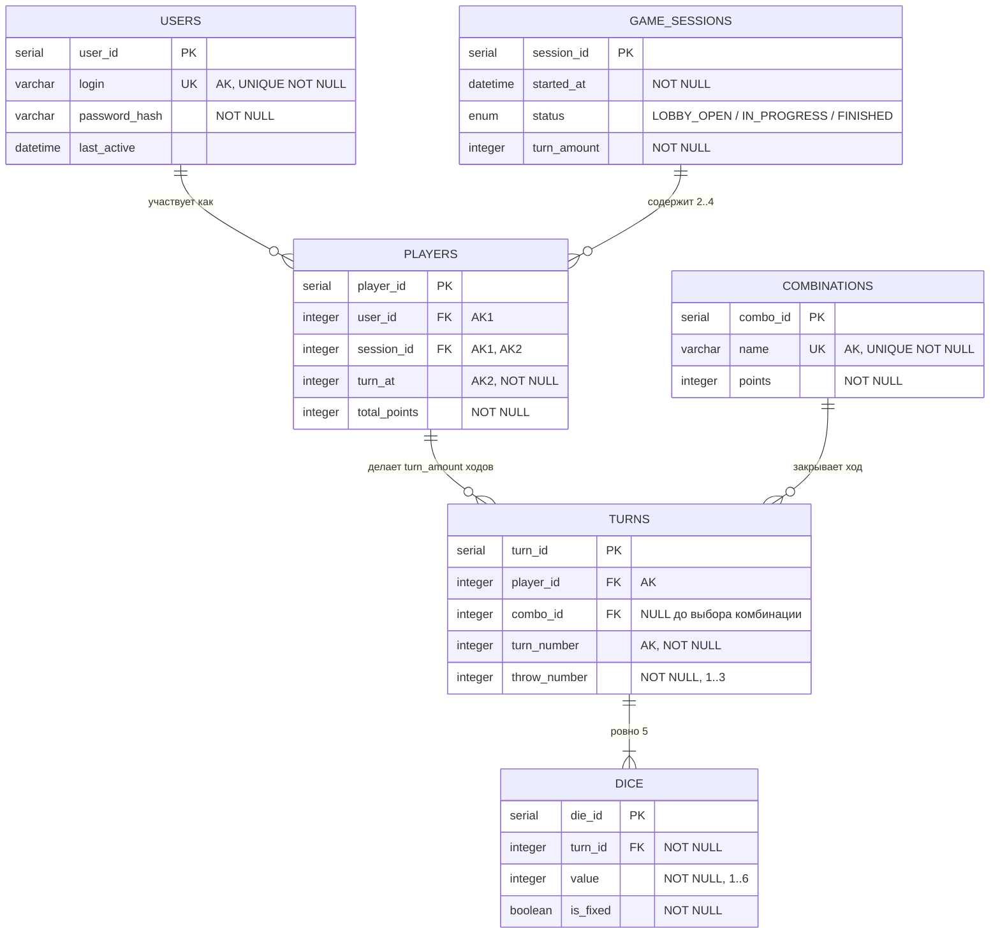
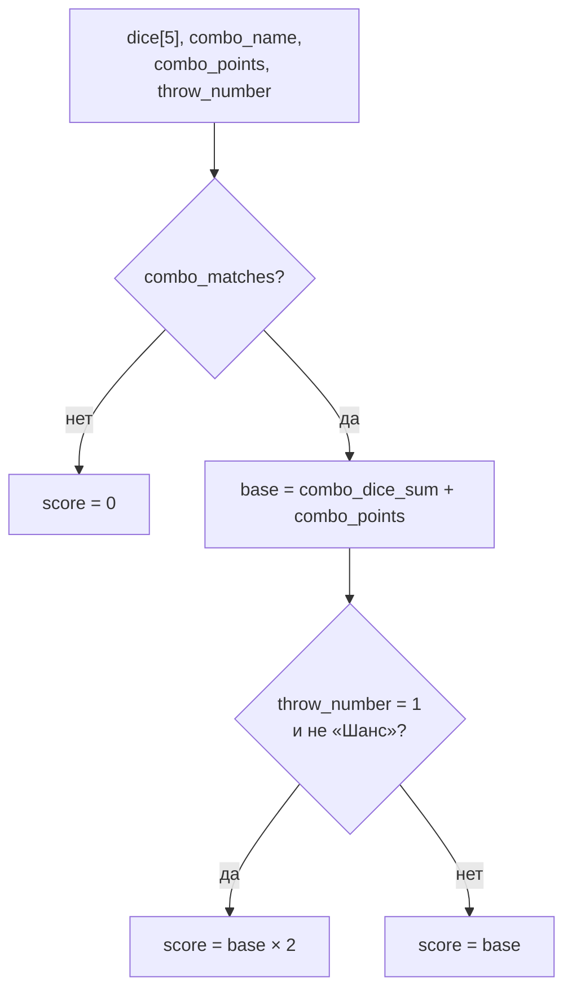
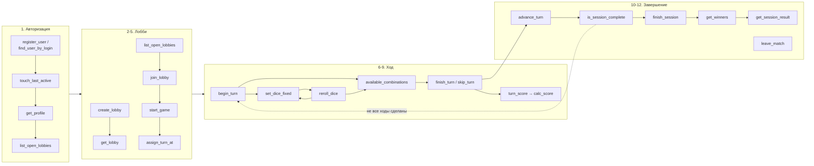

# Poker API — SQL-функции

Перечень функций уровня БД для сценариев из [`api-schema.md`](./api-schema.md) и правил из [`game-rules.md`](./game-rules.md).

Схема данных взята из `poker_DB.drawio` (физический уровень) — имена таблиц, колонок и типов ниже соответствуют ей, функции написаны под неё.

Договорённости:

* Диалект — **PostgreSQL**, функции на `PL/pgSQL`, расчёты комбинаций — на `SQL` с `IMMUTABLE`.
* Идентификаторы — `SERIAL`/`integer`, как в схеме.
* Пароль **не** попадает в БД: `register_user` принимает готовый `password_hash`.
* Auth Token в схеме не хранится — его держит и проверяет сервер (см. `api-schema.md`); БД отмечает только `Users.last_active`.
* Валидация бизнес-правил — внутри функций, через `RAISE EXCEPTION ... USING ERRCODE`, см. [Коды ошибок](#коды-ошибок).
* Кости передаются как `integer[]` — идентификаторы (`die_id`) или значения `1..6`.

---

## Модель данных

Ссылочные действия из схемы: `Players → Users`, `Players → Game_sessions`, `Turns → Players`, `Dice → Turns` — `ON UPDATE CASCADE ON DELETE CASCADE`; `Turns → Combinations` — `ON UPDATE CASCADE ON DELETE SET NULL`.

**Ключевое следствие для функций:** ход адресуется через `player_id`, а не через пару (`session_id`, `user_id`) — `Players` имеет собственный суррогатный ключ, уникальный в пределах сессии (`AK1 = user_id + session_id`), и порядок хода хранится в `Players.turn_at`.

---

## 1. Пользователи и вход

| Функция | Аргументы | Возвращает | Назначение | Проверки |
|---|---|---|---|---|
| `register_user` | `p_login varchar`, `p_password_hash varchar` | `integer` (`user_id`) | Регистрация, `INSERT INTO Users` | `login` уникален и непустой, хеш непустой |
| `find_user_by_login` | `p_login varchar` | `TABLE(user_id integer, login varchar, password_hash varchar)` | Вход — сервер сам сверяет хеш | — (пустой результат = нет пользователя) |
| `touch_last_active` | `p_user_id integer` | `void` | `UPDATE Users.last_active = now()` при каждом запросе с валидным токеном | пользователь существует |
| `get_profile` | `p_user_id integer` | `TABLE(user_id integer, login varchar, last_active datetime, games_played integer, games_won integer, best_total integer)` | Страница профиля (сценарии 1 и 12), агрегаты по `Players` | пользователь существует |

## 2. Лобби

| Функция | Аргументы | Возвращает | Назначение | Проверки |
|---|---|---|---|---|
| `create_lobby` | `p_user_id integer`, `p_turn_amount integer` | `integer` (`session_id`) | `INSERT Game_sessions` со `status = LOBBY_OPEN` + `join_lobby` создателя | `p_turn_amount >= 1`, пользователь не состоит в другой незавершённой сессии |
| `list_open_lobbies` | `p_limit integer DEFAULT 50`, `p_offset integer DEFAULT 0` | `TABLE(session_id integer, turn_amount integer, players_count integer, started_at datetime)` | Поиск лобби (сценарий 3) | только `status = LOBBY_OPEN` и `players_count < 4` |
| `get_lobby` | `p_session_id integer` | `TABLE(session_id integer, status text, turn_amount integer, players jsonb)` | Карточка лобби: состав игроков с `turn_at` | сессия существует |
| `join_lobby` | `p_session_id integer`, `p_user_id integer` | `integer` (`player_id`) | `INSERT Players` с `turn_at` = следующий свободный номер, `total_points = 0` | `status = LOBBY_OPEN`, игроков `< 4`, пользователь ещё не в этом лобби |
| `leave_lobby` | `p_session_id integer`, `p_user_id integer` | `void` | Выход до старта, `turn_at` остальных пересчитывается; при уходе последнего сессия удаляется | `status = LOBBY_OPEN`, игрок состоит в лобби |
| `start_game` | `p_session_id integer`, `p_user_id integer` | `TABLE(session_id integer, current_player_id integer, turn_number integer)` | `UPDATE status = IN_PROGRESS`, `started_at = now()`, раздача `turn_at` | `status = LOBBY_OPEN`, `2..4` игрока |
| `assign_turn_at` | `p_session_id integer` | `void` | Служебная: случайная перестановка `Players.turn_at` в `1..players_count` при старте | вызывается только из `start_game` |
| `leave_match` | `p_session_id integer`, `p_user_id integer` | `TABLE(user_id integer, login varchar)` | Выход из матча (сценарий 12), возвращает профиль | игрок состоит в сессии; незакрытый ход закрывается с 0 очков |

## 3. Игровой процесс: ход

| Функция | Аргументы | Возвращает | Назначение | Проверки |
|---|---|---|---|---|
| `current_player` | `p_session_id integer` | `integer` (`player_id`) | Чей сейчас ход — по `Players.turn_at` и числу закрытых ходов | `status = IN_PROGRESS` |
| `assert_player_turn` | `p_player_id integer` | `void` | Служебная проверка «это твой ход», используется всеми функциями хода | сессия игрока `IN_PROGRESS`, `p_player_id = current_player()` |
| `is_turn_closed` | `p_turn_id integer` | `boolean` | Ход закрыт, если `combo_id IS NOT NULL`; ход без комбинации после третьего броска — см. [расхождения со схемой](#расхождения-со-схемой-которые-закрывают-функции) | ход существует |
| `begin_turn` | `p_player_id integer` | `TABLE(turn_id integer, turn_number integer, throw_number integer, dice jsonb)` | `INSERT Turns` (`turn_number` = следующий, `throw_number = 1`, `combo_id = NULL`) + 5 костей с `is_fixed = FALSE` | ход игрока, нет незакрытого хода, сделано `< turn_amount` ходов |
| `roll_dice_values` | `p_count integer` | `integer[]` | Служебная: генерация `p_count` значений `1..6` (`VOLATILE`) | `p_count` в `1..5` |
| `set_dice_fixed` | `p_turn_id integer`, `p_fixed_die_ids integer[]` | `TABLE(die_id integer, value integer, is_fixed boolean)` | `UPDATE Dice.is_fixed` — фиксация и снятие фиксации одним вызовом (полный список фиксируемых) | ход игрока и не закрыт, `throw_number < 3`, все `die_id` принадлежат этому ходу, их не более 5 |
| `reroll_dice` | `p_turn_id integer` | `TABLE(throw_number integer, dice jsonb)` | Переброс только `is_fixed = FALSE` и `throw_number + 1` | ход игрока и не закрыт, `throw_number < 3`, есть хотя бы одна нефиксированная кость |
| `get_turn_state` | `p_turn_id integer` | `TABLE(turn_id integer, turn_number integer, throw_number integer, dice jsonb, combo_id integer, score integer)` | Состояние хода, в том числе для восстановления после реконнекта | ход существует |
| `turn_dice_values` | `p_turn_id integer` | `integer[]` | Служебная: 5 значений костей хода для чистых функций подсчёта | ход существует, ровно 5 костей |
| `available_combinations` | `p_turn_id integer` | `TABLE(combo_id integer, name varchar, points integer, potential_score integer)` | Комбинации, подходящие под текущие кости, с предварительным счётом (правило «несколько вариантов») | ход существует и не закрыт |
| `turn_score` | `p_turn_id integer` | `integer` | Очки за ход — **вычисляются**, в `Turns` колонки `score` нет: `calc_score(кости, name, points, throw_number)` | ход существует; `combo_id IS NULL` → `0` |
| `finish_turn` | `p_turn_id integer`, `p_combo_id integer` | `TABLE(score integer, total_points integer)` | `UPDATE Turns.combo_id` + `Players.total_points += turn_score()` | ход игрока и не закрыт, комбинация существует и соответствует текущим костям |
| `skip_turn` | `p_turn_id integer` | `TABLE(score integer, total_points integer)` | Закрытие хода без комбинации после трёх бросков — `score = 0` | ход игрока и не закрыт, `throw_number = 3` |
| `advance_turn` | `p_session_id integer` | `TABLE(current_player_id integer, turn_number integer, standings jsonb)` | Переход хода к следующему по `turn_at` (сценарий 10) | `status = IN_PROGRESS`, предыдущий ход закрыт |

## 4. Комбинации и подсчёт очков (чистые функции, `IMMUTABLE`)

Функции принимают значения костей как `integer[]` длины 5, не обращаются к таблицам и полностью повторяют раздел «Комбинации» из [`game-rules.md`](./game-rules.md) — их можно тестировать изолированно и переиспользовать и в `available_combinations`, и в `turn_score`.

| Функция | Аргументы | Возвращает | Комбинация / назначение | Очки (`Combinations.points`) |
|---|---|---|---|---|
| `dice_counts` | `p_dice integer[]` | `integer[]` длины 6 | Гистограмма: сколько костей каждого номинала `1..6` | — |
| `has_pair` | `p_dice integer[]` | `boolean` | Пара — есть номинал с `count >= 2` | 5 |
| `has_two_pairs` | `p_dice integer[]` | `boolean` | Две пары — два разных номинала с `count >= 2` | 10 |
| `has_three_of_a_kind` | `p_dice integer[]` | `boolean` | Тройка — `count >= 3` | 15 |
| `has_small_straight` | `p_dice integer[]` | `boolean` | Малый стрит — `1-2-3-4`, `2-3-4-5` или `3-4-5-6` | 20 |
| `has_large_straight` | `p_dice integer[]` | `boolean` | Большой стрит — `1-2-3-4-5` или `2-3-4-5-6` | 25 |
| `has_even` | `p_dice integer[]` | `boolean` | Чёт — все пять костей чётные | 30 |
| `has_odd` | `p_dice integer[]` | `boolean` | Нечёт — все пять костей нечётные | 30 |
| `has_full_house` | `p_dice integer[]` | `boolean` | Фул-хаус — номинал с `count = 3` и другой с `count = 2` | 35 |
| `has_four_of_a_kind` | `p_dice integer[]` | `boolean` | Каре — `count >= 4` | 40 |
| `has_poker` | `p_dice integer[]` | `boolean` | Покер — `count = 5` | 50 |
| `has_chance` | `p_dice integer[]` | `boolean` | Шанс — все пять значений различны | 2 |
| `combo_matches` | `p_dice integer[]`, `p_combo_name varchar` | `boolean` | Диспетчер: проверка костей на комбинацию по её `Combinations.name` | — |
| `combo_dice_sum` | `p_dice integer[]`, `p_combo_name varchar` | `integer` | Сумма только тех костей, что образуют комбинацию; при нескольких вариантах — максимальная | — |
| `calc_score` | `p_dice integer[]`, `p_combo_name varchar`, `p_combo_points integer`, `p_throw_number integer` | `integer` | Итог: `combo_dice_sum + points`, с удвоением при комбинации с первого броска, кроме «Шанса»; `0`, если комбинация не соответствует костям | — |

Формула `calc_score` — см. [раздел 5 правил](./game-rules.md#5-начисление-очков).

## 5. Завершение партии

| Функция | Аргументы | Возвращает | Назначение | Проверки |
|---|---|---|---|---|
| `is_session_complete` | `p_session_id integer` | `boolean` | Все ли игроки сделали `turn_amount` закрытых ходов | сессия существует |
| `get_standings` | `p_session_id integer` | `TABLE(player_id integer, user_id integer, login varchar, total_points integer, turns_played integer, place integer)` | Таблица результатов, в том числе во время партии | сессия существует |
| `finish_session` | `p_session_id integer` | `TABLE(status text, results jsonb, winner_ids integer[])` | `UPDATE status = FINISHED`, расчёт победителей | `status = IN_PROGRESS`, `is_session_complete() = TRUE` |
| `get_winners` | `p_session_id integer` | `integer[]` | Игроки с максимальным `total_points`; при равенстве — несколько id (ничья) | сессия существует |
| `get_session_result` | `p_session_id integer` | `TABLE(status text, results jsonb, winner_ids integer[])` | Чтение страницы результатов после завершения | `status = FINISHED` |

## 6. Служебные функции и триггеры

| Объект | Тип | Назначение |
|---|---|---|
| `recalc_total_points(p_player_id)` | функция | Пересчёт `Players.total_points` как `SUM(turn_score(turn_id))` по всем закрытым ходам игрока — страховка от расхождений денормализации |
| `seed_combinations()` | функция | Наполнение справочника `Combinations` 11 комбинациями из правил (`name`, `points`) |
| `trg_turns_after_combo` | триггер `AFTER UPDATE OF combo_id ON Turns` | При выборе комбинации обновляет `Players.total_points` и при `is_session_complete()` вызывает `finish_session` |
| `trg_players_limit` | триггер `BEFORE INSERT ON Players` | Запрет 5-го игрока в сессии и вставки в сессию со `status != LOBBY_OPEN` |
| `trg_dice_count` | триггер `AFTER INSERT ON Dice` (`DEFERRABLE INITIALLY DEFERRED`) | Проверка, что у хода ровно 5 костей |
| `trg_dice_value_range` | триггер / `CHECK` | `Dice.value` в `1..6` |
| `trg_turns_throw_range` | триггер / `CHECK` | `Turns.throw_number` в `1..3`, `turn_number` в `1..turn_amount` сессии |
| `trg_sessions_status` | триггер `BEFORE UPDATE ON Game_sessions` | Разрешает только переходы `LOBBY_OPEN → IN_PROGRESS → FINISHED` |

---

## Карта «сценарий API → функции»

Каждый вызов, кроме `register_user` и `find_user_by_login`, на сервере предваряется проверкой Auth Token и вызовом `touch_last_active`.

---

## Коды ошибок

Единый набор `ERRCODE` для `RAISE EXCEPTION`, чтобы сервер однозначно мапил их в HTTP-ответы.

| `ERRCODE` | Константа | Смысл | HTTP |
|---|---|---|---|
| `23505` | `login_already_taken` | Логин занят | 409 |
| `P0101` | `lobby_not_found` | Сессия не существует | 404 |
| `P0102` | `lobby_not_open` | `status != LOBBY_OPEN` | 409 |
| `P0103` | `lobby_full` | В лобби уже 4 игрока | 409 |
| `P0104` | `already_joined` | Пользователь уже в этом лобби | 409 |
| `P0105` | `not_enough_players` | Для старта нужно `2..4` игрока | 409 |
| `P0201` | `not_your_turn` | Ход другого игрока | 403 |
| `P0202` | `turn_already_closed` | Ход уже закрыт комбинацией | 409 |
| `P0203` | `no_throws_left` | `throw_number = 3`, переброс запрещён | 409 |
| `P0204` | `combo_not_available` | Комбинация не соответствует костям | 422 |
| `P0205` | `throws_not_exhausted` | `skip_turn` до третьего броска | 409 |
| `P0301` | `session_not_complete` | Не все игроки сделали `turn_amount` ходов | 409 |
| `P0302` | `session_finished` | Действие в завершённой партии | 409 |
