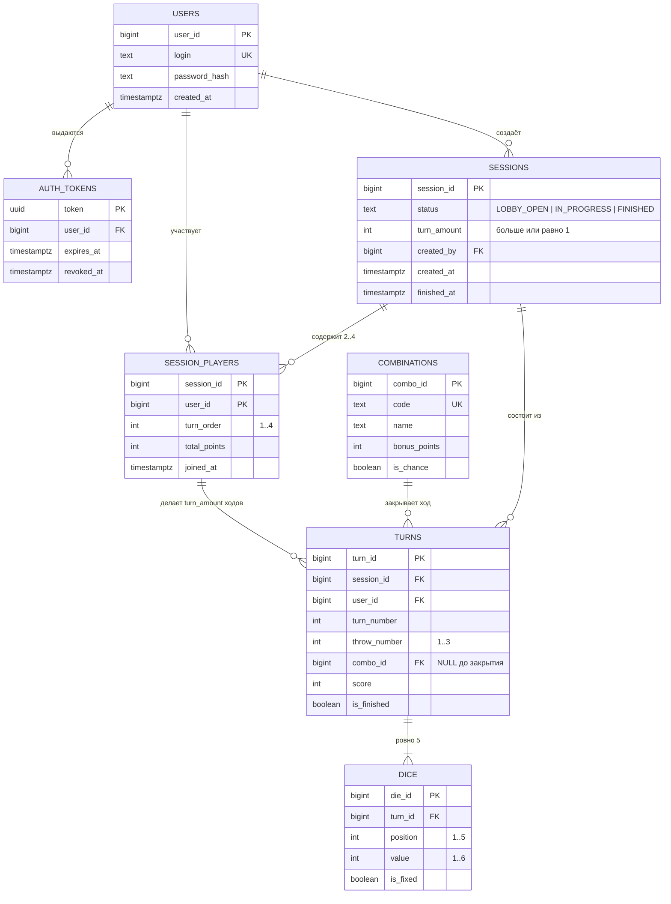
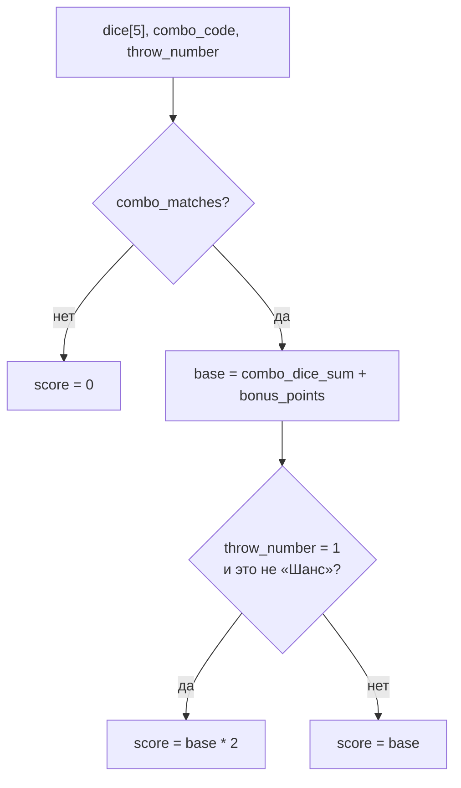
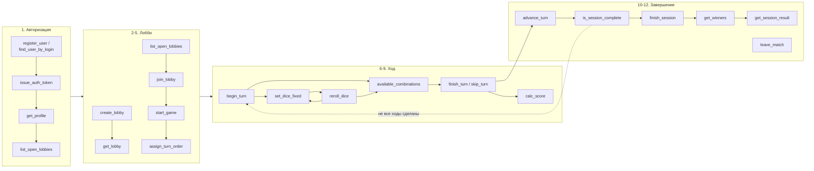

# Poker API — SQL-функции

Перечень функций уровня БД, которые нужны для сценариев из [`api-schema.md`](./api-schema.md).

Договорённости:

* Диалект — **PostgreSQL**, функции на `PL/pgSQL`, чистые расчёты — на `SQL` с `IMMUTABLE`.
* Идентификаторы — `bigint` (`GENERATED ALWAYS AS IDENTITY`), время — `timestamptz`.
* Пароль **не** попадает в БД: функция регистрации принимает уже готовый `password_hash`.
* Токен проверяет сервер, но для срока жизни и ревокации токены хранятся в БД.
* Валидация бизнес-правил — внутри функций, через `RAISE EXCEPTION ... USING ERRCODE`, см. [Коды ошибок](#коды-ошибок).
* Кости передаются как `bigint[]` (идентификаторы) или `int[]` (значения `1..6`).

---

## Модель данных

---

## 1. Аутентификация и токены

| Функция | Аргументы | Возвращает | Назначение | Проверки |
|---|---|---|---|---|
| `register_user` | `p_login text`, `p_password_hash text` | `bigint` (`user_id`) | Регистрация, `INSERT INTO users` | `login` уникален и непустой, хеш непустой |
| `find_user_by_login` | `p_login text` | `TABLE(user_id bigint, login text, password_hash text)` | Вход — сервер сам сверяет хеш | — (пустой результат = нет пользователя) |
| `issue_auth_token` | `p_user_id bigint`, `p_ttl interval DEFAULT '24h'` | `uuid` | Выдача токена после успешного входа | пользователь существует |
| `validate_auth_token` | `p_token uuid` | `bigint` (`user_id`) | Резолв токена в пользователя | токен существует, не отозван, `expires_at > now()` |
| `revoke_auth_token` | `p_token uuid` | `void` | Выход из аккаунта | — (идемпотентна) |
| `get_profile` | `p_user_id bigint` | `TABLE(user_id bigint, login text, games_played int, games_won int, best_score int)` | Страница профиля (сценарии 1 и 12) | пользователь существует |

## 2. Лобби

| Функция | Аргументы | Возвращает | Назначение | Проверки |
|---|---|---|---|---|
| `create_lobby` | `p_user_id bigint`, `p_turn_amount int` | `bigint` (`session_id`) | `INSERT` сессии со `status = LOBBY_OPEN` + автоматический вход создателя | `p_turn_amount >= 1`, пользователь не состоит в другой активной сессии |
| `list_open_lobbies` | `p_limit int DEFAULT 50`, `p_offset int DEFAULT 0` | `TABLE(session_id bigint, turn_amount int, players_count int, created_at timestamptz)` | Поиск лобби (сценарий 3) | возвращает только `status = LOBBY_OPEN` и `players_count < 4` |
| `get_lobby` | `p_session_id bigint` | `TABLE(session_id bigint, status text, turn_amount int, players jsonb)` | Карточка лобби | сессия существует |
| `join_lobby` | `p_session_id bigint`, `p_user_id bigint` | `TABLE(session_id bigint, status text, players jsonb)` | Вход игрока в лобби | `status = LOBBY_OPEN`, игроков `< 4`, пользователь ещё не в этом лобби |
| `leave_lobby` | `p_session_id bigint`, `p_user_id bigint` | `void` | Выход до старта, при уходе последнего лобби закрывается | `status = LOBBY_OPEN`, игрок состоит в лобби |
| `start_game` | `p_session_id bigint`, `p_user_id bigint` | `TABLE(session_id bigint, current_player_id bigint, turn_number int)` | `UPDATE status = IN_PROGRESS`, раздача `turn_order` | `status = LOBBY_OPEN`, `2..4` игрока, `p_user_id` — создатель лобби |
| `assign_turn_order` | `p_session_id bigint` | `void` | Служебная: случайная перестановка `turn_order` при старте | вызывается только из `start_game` |
| `leave_match` | `p_session_id bigint`, `p_user_id bigint` | `TABLE(user_id bigint, login text)` | Выход из матча (сценарий 12), возвращает профиль | игрок состоит в сессии, незавершённый ход помечается закрытым |

## 3. Игровой процесс: ход

| Функция | Аргументы | Возвращает | Назначение | Проверки |
|---|---|---|---|---|
| `current_player` | `p_session_id bigint` | `bigint` (`user_id`) | Чей сейчас ход — по `turn_order` и числу завершённых ходов | `status = IN_PROGRESS` |
| `assert_player_turn` | `p_session_id bigint`, `p_user_id bigint` | `void` | Служебная проверка «это твой ход», используется всеми функциями хода | `status = IN_PROGRESS`, `p_user_id = current_player()` |
| `begin_turn` | `p_session_id bigint`, `p_user_id bigint` | `TABLE(turn_id bigint, throw_number int, dice jsonb)` | `INSERT` хода + 5 костей, первый бросок всеми костями | ход игрока, нет незавершённого хода, сделано `< turn_amount` ходов |
| `roll_dice_values` | `p_count int` | `int[]` | Служебная: генерация `p_count` значений `1..6` (`VOLATILE`) | `p_count` в `1..5` |
| `set_dice_fixed` | `p_turn_id bigint`, `p_user_id bigint`, `p_fixed_die_ids bigint[]` | `TABLE(die_id bigint, value int, is_fixed boolean)` | `UPDATE dice.is_fixed` — фиксация и освобождение | ход игрока, ход не завершён, `throw_number < 3`, все `die_id` принадлежат этому ходу |
| `reroll_dice` | `p_turn_id bigint`, `p_user_id bigint` | `TABLE(throw_number int, dice jsonb)` | Переброс только `is_fixed = FALSE` и `throw_number + 1` | ход игрока, ход не завершён, `throw_number < 3`, есть хотя бы одна нефиксированная кость |
| `get_turn_state` | `p_turn_id bigint` | `TABLE(turn_id bigint, turn_number int, throw_number int, dice jsonb, combo_id bigint, score int)` | Текущее состояние хода (восстановление после реконнекта) | ход существует |
| `available_combinations` | `p_turn_id bigint` | `TABLE(combo_id bigint, code text, name text, potential_score int)` | Комбинации, доступные на текущих костях, с предварительным счётом | ход существует и не завершён, исключает уже закрытые игроком комбинации |
| `finish_turn` | `p_turn_id bigint`, `p_user_id bigint`, `p_combo_id bigint` | `TABLE(score int, total_points int)` | Запись `combo_id` и `score`, инкремент `total_points` | ход игрока, ход не завершён, комбинация доступна на текущих костях и не закрыта ранее |
| `skip_turn` | `p_turn_id bigint`, `p_user_id bigint` | `TABLE(score int, total_points int)` | Закрытие хода без комбинации после 3 бросков — `score = 0` | ход игрока, `throw_number = 3` |
| `advance_turn` | `p_session_id bigint` | `TABLE(current_player_id bigint, turn_number int, standings jsonb)` | Переход хода к следующему игроку (сценарий 10) | `status = IN_PROGRESS`, предыдущий ход завершён |

## 4. Подсчёт очков (чистые функции, `IMMUTABLE`)

Функции этой группы принимают значения костей как `int[]` длины 5 и не обращаются к таблицам — их можно тестировать изолированно и переиспользовать и в `available_combinations`, и в `finish_turn`.

| Функция | Аргументы | Возвращает | Назначение |
|---|---|---|---|
| `dice_counts` | `p_dice int[]` | `int[]` длины 6 | Гистограмма: сколько костей каждого номинала `1..6` |
| `has_number` | `p_dice int[]`, `p_face int` | `boolean` | Есть ли кость заданного номинала (комбинации «Единицы».. «Шестёрки») |
| `has_pair` | `p_dice int[]` | `boolean` | Пара |
| `has_two_pairs` | `p_dice int[]` | `boolean` | Две пары |
| `has_three_of_a_kind` | `p_dice int[]` | `boolean` | Тройка |
| `has_four_of_a_kind` | `p_dice int[]` | `boolean` | Каре |
| `has_full_house` | `p_dice int[]` | `boolean` | Фулл-хаус, 3 + 2 |
| `has_small_straight` | `p_dice int[]` | `boolean` | Малый стрит `1-2-3-4-5` |
| `has_large_straight` | `p_dice int[]` | `boolean` | Большой стрит `2-3-4-5-6` |
| `has_poker` | `p_dice int[]` | `boolean` | Покер, 5 одинаковых |
| `combo_matches` | `p_dice int[]`, `p_combo_code text` | `boolean` | Диспетчер: проверка костей на конкретную комбинацию по её `code` |
| `combo_dice_sum` | `p_dice int[]`, `p_combo_code text` | `int` | Сумма костей, входящих в комбинацию (для номинальных — сумма костей этого номинала) |
| `calc_score` | `p_dice int[]`, `p_combo_code text`, `p_throw_number int` | `int` | Итог: `combo_dice_sum + bonus_points`, с удвоением при комбинации с 1-го броска, кроме «Шанса» |

Правила, которые закрывает `calc_score` (из сценария 9):

## 5. Завершение партии

| Функция | Аргументы | Возвращает | Назначение | Проверки |
|---|---|---|---|---|
| `is_session_complete` | `p_session_id bigint` | `boolean` | Все ли игроки сделали `turn_amount` завершённых ходов | сессия существует |
| `get_standings` | `p_session_id bigint` | `TABLE(user_id bigint, login text, total_points int, turns_played int, place int)` | Таблица результатов, в том числе во время партии | сессия существует |
| `finish_session` | `p_session_id bigint` | `TABLE(status text, results jsonb, winner_ids bigint[])` | `UPDATE status = FINISHED`, расчёт победителей | `status = IN_PROGRESS`, `is_session_complete() = TRUE` |
| `get_winners` | `p_session_id bigint` | `bigint[]` | Все игроки с максимальным `total_points` (ничья — несколько id) | сессия существует |
| `get_session_result` | `p_session_id bigint` | `TABLE(status text, results jsonb, winner_ids bigint[])` | Чтение страницы результатов после завершения | `status = FINISHED` |

## 6. Служебные функции и триггеры

| Объект | Тип | Назначение |
|---|---|---|
| `recalc_total_points(p_session_id, p_user_id)` | функция | Пересчёт `session_players.total_points` как `SUM(turns.score)` — страховка от расхождений |
| `trg_turns_after_finish` | триггер `AFTER UPDATE ON turns` | При `is_finished = TRUE` обновляет `total_points` и при `is_session_complete()` вызывает `finish_session` |
| `trg_session_players_limit` | триггер `BEFORE INSERT ON session_players` | Жёсткий запрет 5-го игрока в сессии |
| `trg_dice_count` | триггер `AFTER INSERT ON dice` (`DEFERRABLE`) | Проверка, что у хода ровно 5 костей |
| `trg_sessions_status` | триггер `BEFORE UPDATE ON sessions` | Разрешает только переходы `LOBBY_OPEN → IN_PROGRESS → FINISHED` |
| `cleanup_expired_tokens()` | функция | Удаление истёкших и отозванных токенов, вызывается по расписанию |

---

## Карта «сценарий API → функции»

Каждый вызов, кроме `register_user`, `find_user_by_login` и `issue_auth_token`, на сервере предваряется `validate_auth_token`.

---

## Коды ошибок

Единый набор `ERRCODE` для `RAISE EXCEPTION`, чтобы сервер однозначно мапил их в HTTP-ответы.

| `ERRCODE` | Константа | Смысл | HTTP |
|---|---|---|---|
| `23505` | `login_already_taken` | Логин занят | 409 |
| `28000` | `invalid_token` | Токен не найден, истёк или отозван | 401 |
| `P0101` | `lobby_not_found` | Сессия не существует | 404 |
| `P0102` | `lobby_not_open` | `status != LOBBY_OPEN` | 409 |
| `P0103` | `lobby_full` | В лобби уже 4 игрока | 409 |
| `P0104` | `already_joined` | Игрок уже в этом лобби | 409 |
| `P0105` | `not_enough_players` | Для старта нужно `2..4` игрока | 409 |
| `P0201` | `not_your_turn` | Ход другого игрока | 403 |
| `P0202` | `turn_already_finished` | Ход уже закрыт комбинацией | 409 |
| `P0203` | `no_throws_left` | `throw_number = 3`, переброс запрещён | 409 |
| `P0204` | `combo_not_available` | Комбинация не соответствует костям | 422 |
| `P0205` | `combo_already_used` | Комбинация уже закрыта этим игроком | 409 |
| `P0301` | `session_not_complete` | Не все игроки сделали `turn_amount` ходов | 409 |
| `P0302` | `session_finished` | Действие в завершённой партии | 409 |
